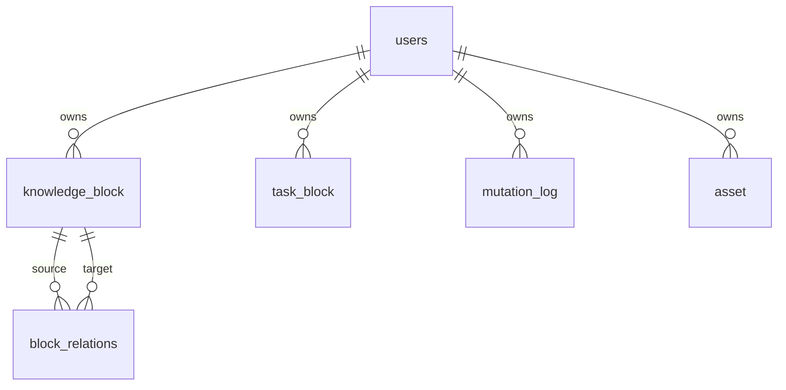

# 数据库设计与数据字典

更新时间：2026-07-08

## 文档来源与维护规则

本文档按当前实体和业务语义整理，重点覆盖用户要求的核心表：

- `users`
- `knowledge_block`
- `task_block`
- `block_relations`
- `mutation_log`
- `asset`
- Mobile / Tablet 本地表：`tablet_notes`

维护规则：

- Entity、Mapper XML、数据库迁移脚本任一发生字段变化，都必须同步更新本文档。
- 删除语义统一前，`knowledge_block` 和 `task_block` 的 `is_deleted` 字段必须按软删除基线处理。
- 当前未发现正式数据库迁移工具配置，后续建议引入 Flyway 或 Liquibase。

## ER 图

## users

| 字段 | 类型 | 约束 | 说明 |
| --- | --- | --- | --- |
| `id` | `VARCHAR(64)` | PK | 用户 ID |
| `username` | `VARCHAR(128)` | UNIQUE, NOT NULL | 用户名 |
| `password` | `VARCHAR(256)` | NOT NULL | 密码哈希，当前使用 BCrypt |

## knowledge_block

| 字段 | 类型 | 约束 | 说明 |
| --- | --- | --- | --- |
| `id` | `VARCHAR(64)` | PK | 知识块 ID |
| `subject` | `VARCHAR(256)` | nullable | 学科名称 |
| `title` | `VARCHAR(512)` | nullable | 标题 |
| `preview` | `TEXT` | nullable | 内容摘要或正文片段 |
| `time` | `VARCHAR(128)` | nullable | 时间文本 |
| `source` | `VARCHAR(128)` | nullable | 来源 |
| `color` | `VARCHAR(64)` | nullable | 前端展示色 |
| `user_id` | `VARCHAR(64)` | index | 所属用户 |
| `sync_version` | `BIGINT` | default 0 | 同步版本 |
| `is_deleted` | `BOOLEAN` | default false | 软删除标记 |
| `encrypted_payload` | `TEXT` | nullable | 预留加密载荷 |

## task_block

| 字段 | 类型 | 约束 | 说明 |
| --- | --- | --- | --- |
| `id` | `VARCHAR(64)` | PK | 任务块 ID |
| `name` | `VARCHAR(256)` | nullable | 任务名称 |
| `subject` | `VARCHAR(256)` | nullable | 学科 |
| `desc` | `TEXT` | nullable | 描述 |
| `color` | `VARCHAR(64)` | nullable | 展示色 |
| `duration` | `INTEGER` | nullable | 预计时长，分钟 |
| `load` | `VARCHAR(64)` | nullable | 脑力负荷 |
| `load_text` | `VARCHAR(256)` | nullable | 负荷展示文本 |
| `status` | `VARCHAR(64)` | nullable | 状态 |
| `start_time` | `VARCHAR(128)` | nullable | 排期时间 |
| `user_id` | `VARCHAR(64)` | index | 所属用户 |
| `sync_version` | `BIGINT` | default 0 | 同步版本 |
| `is_deleted` | `BOOLEAN` | default false | 软删除标记 |
| `encrypted_payload` | `TEXT` | nullable | 预留加密载荷 |
| `position` | `VARCHAR(256)` | default `0` | 排序位置 |

## block_relations

| 字段 | 类型 | 约束 | 说明 |
| --- | --- | --- | --- |
| `id` | `VARCHAR(64)` | PK | 关系 ID |
| `source_id` | `VARCHAR(64)` | NOT NULL | 源块 ID |
| `target_id` | `VARCHAR(64)` | NOT NULL | 目标块 ID |
| `relation_type` | `VARCHAR(64)` | NOT NULL | 关系类型 |

## mutation_log

| 字段 | 类型 | 约束 | 说明 |
| --- | --- | --- | --- |
| `id` | `BIGSERIAL` | PK | 服务端 mutation ID |
| `client_id` | `VARCHAR(64)` | NOT NULL | 客户端 ID |
| `user_id` | `VARCHAR(64)` | NOT NULL, index | 所属用户 |
| `entity_type` | `VARCHAR(64)` | NOT NULL | 实体类型，如 block/task |
| `entity_id` | `VARCHAR(64)` | NOT NULL | 实体 ID |
| `action` | `VARCHAR(64)` | NOT NULL | create/update/delete |
| `payload` | `JSONB` | NOT NULL | 变更载荷 |
| `created_at` | `BIGINT` | NOT NULL | 创建时间戳 |

## asset

| 字段 | 类型 | 约束 | 说明 |
| --- | --- | --- | --- |
| `id` | `VARCHAR(64)` | PK | 资产 ID |
| `user_id` | `VARCHAR(64)` | NOT NULL, index | 所属用户 |
| `file_name` | `VARCHAR(512)` | NOT NULL | 原始文件名 |
| `object_name` | `VARCHAR(1024)` | NOT NULL | MinIO 对象名 |
| `file_size` | `BIGINT` | nullable | 文件大小 |
| `content_type` | `VARCHAR(128)` | nullable | MIME 类型 |
| `status` | `VARCHAR(32)` | default PENDING | PENDING/PROCESSING/COMPLETED/FAILED |
| `subject` | `VARCHAR(256)` | default 文档导入 | 学科 |
| `created_at` | `BIGINT` | NOT NULL | 创建时间戳 |

## Mobile / Tablet 本地表

`StudyCore-Mobile` 在端侧 SQLite 中维护以下本地表。该表当前不进入服务端同步，不影响后端 API。

### tablet_notes

| 字段 | 类型 | 约束 | 说明 |
| --- | --- | --- | --- |
| `id` | `TEXT` | PK | 本地手写文档 ID；文件批注使用 `subject-asset-annotation:{subjectId}:{assetId}` |
| `mode` | `TEXT` | index | `subject-asset-annotation`、`subject-handwriting-note`、`quick-infinite-canvas` |
| `subject_id` | `TEXT` | index, nullable | 所属学科 ID |
| `asset_id` | `TEXT` | index, nullable | 文件批注绑定的资料 ID |
| `title` | `TEXT` | nullable | 文档标题 |
| `data` | `TEXT` | NOT NULL | 序列化后的 `NoteDocument`，包含 pages、strokes、viewport、background |
| `updated_at` | `TEXT` | index | 最近更新时间 |

## 同步字段说明

- `user_id`：所有用户数据必须带此字段作为隔离边界。
- `sync_version`：用于多端同步版本比较。
- `is_deleted`：用于软删除，避免冷启动时误恢复已删除数据。
- `created_at`：MutationLog 的服务端顺序游标。
