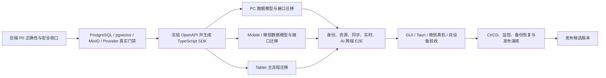

> [!WARNING]
> 本文是 2026-08-16 的审计快照，于 2026-10-28 移入历史归档。正文的“当前”“未完成”和测试结果均指审计时点；不作为现行工程判断或待办来源。请从[文档中心](../../README.md)读取当前状态与风险。仅重定位相对链接，原始文件另有逐字节备份。

# Auralis 整体项目未完成项综合审计

审计日期：2026-08-16

文档状态：现行审计快照

审计对象：当前工作树中的产品范围、文档、PC、Mobile、微信小程序、Tablet、后端、数据与同步、AI / RAG、基础设施和发布准备

事实来源：当前代码与配置、[当前状态](../../current/Status.md)、[问题和审查](../../current/IssuesAndReview.md)、各模块与契约文档，以及本轮实际执行的验证命令

## 1. 结论先行

当前项目已经不是“从零开发”阶段：PC、Mobile、Tablet 和新后端都已有较大规模代码，后端阶段 1 至阶段 5 的主体接口也已经落地，PC、H5、微信小程序和后端测试在本轮均获得了可重复的构建或自动测试证据。

但项目仍不具备发布候选版本交付条件。更准确的整体状态是：

> **核心代码已大面积构建，正在进入后端正确性收口、契约冻结、全端迁移、真实依赖联调和发布工程补齐阶段。**

当前最关键的问题不是继续增加页面数量，而是把已存在的多套实现收敛成一条可部署、可联调、可验收、可恢复的主链路：

1. 新后端仍有安全、并发、游标、后台任务、真实向量检索和流式语义等正确性缺口。
2. PC 与 Mobile 仍保留旧接口、旧 WebSocket 路径、本地模型和硬编码地址，尚未迁移到新后端契约。
3. PostgreSQL / pgvector、MinIO、真实模型供应商、双设备同步、浏览器 WebSocket、Tauri 和微信真机均未形成完整验收证据。
4. 部署拓扑、Dockerfile、CI/CD、监控、备份恢复、密钥治理和发布演练未闭环。
5. 多份项目级、运维级和计划级文档仍描述旧后端技术栈，当前工程事实存在漂移。

因此，不能用一个单一“完成百分比”表达当前项目。代码存在、自动测试通过、真实服务联调通过、GUI / 真机验收通过和发布门禁通过是五种不同状态，必须分别判断。

## 2. 审计口径

### 2.1 状态词

| 状态 | 本报告中的含义 |
| --- | --- |
| 已验收 | 已满足完成定义，并有自动、联调或人工证据 |
| 已构建待验收 | 代码或页面存在，且至少有构建证据，但真实联调或人工验收不足 |
| 进行中 | 主体已存在，但关键能力、测试、迁移或文档仍未闭环 |
| 计划中 | 只有需求或计划，尚未形成可验证实现 |
| 已隐藏保留 | 实现仍在代码中，但入口或能力由路由 / feature flag 关闭 |
| 阻塞 | 当前依赖外部服务、设备、权限、产品决策或基础设施条件 |

### 2.2 五维完成判断

- **代码基线**：实现是否存在，结构是否覆盖目标领域。
- **自动验证**：构建、单元、集成或静态检查是否可执行且通过。
- **真实联调**：是否连接真实 PostgreSQL / pgvector、MinIO、模型供应商、浏览器、设备和多个客户端。
- **人工验收**：是否完成 GUI、交互、真机、异常路径和业务流程确认。
- **发布门禁**：是否有可部署镜像、环境配置、CI/CD、监控、备份、回滚和发布清单。

### 2.3 审计边界

- 本报告基于 2026-08-16 的当前脏工作树，而不是仅基于 `HEAD`。
- 自动命令通过只证明该命令覆盖的范围，不代替真实服务、GUI 或业务验收。
- 本轮只创建审计文档和索引，不修改业务代码，不提交 Git。
- 按现行后端重写计划，旧服务数据自动迁移、跨实例消息 Broker、Tablet 手写笔记云同步、其它小程序平台、AI 自动执行领域写操作暂不作为当前首个发布候选版本的强制范围；若产品决定纳入，必须重新评估优先级和完成定义。

## 3. 整体完成矩阵

| 领域 | 当前状态 | 代码基线 | 自动验证 | 真实联调 | 人工验收 | 发布门禁 |
| --- | --- | --- | --- | --- | --- | --- |
| 产品范围与文档治理 | 进行中 | 现行入口与主要模块文档已建立 | 部分链接与文档人工核对 | 不适用 | 范围和发布定义未统一签字 | 未就绪 |
| 新后端核心领域 | 已构建待验收 | 身份、核心领域、资源、同步、复习、统计、实时已实现 | `92/92` 测试通过 | 真实 PostgreSQL / MinIO / 双设备未完成 | 未完成 | 未就绪 |
| AI / RAG | 进行中 | 设置、对话、摄取、检索、建议接口已存在 | H2 测试纳入后端测试集 | 真实 Provider / pgvector 路径未完成 | 质量与流式体验未验收 | 未就绪 |
| PC Web | 已构建待验收 | 主要页面、Store 和本地数据层存在 | 图标、工作区静态检查和 Vite 构建通过 | 新后端主链路未迁移 | GUI / 窄屏 / 暗色 / 异常流未闭环 | 未就绪 |
| PC Tauri | 进行中 | Tauri 壳、本地 SQL / 文件 / 窗口能力存在 | 本轮未执行 Tauri 完整构建 | 仍使用旧 WebSocket 地址和协议 | 桌面权限、安装、升级未验收 | 未就绪 |
| Mobile H5 | 已构建待验收 | 移动端页面和本地 Store 已存在 | H5 正式构建通过；类型检查阻塞 | 新后端主链路未迁移 | 浏览器与真机未闭环 | 未就绪 |
| 微信小程序 | 已构建待验收 | Uni-app 微信目标可产物化 | `build:mp-weixin` 通过 | 合法 HTTPS / WSS 域名、AppID 和后端未联调 | 微信开发者工具与真机未验收 | 阻塞 |
| Tablet | 进行中 | 横屏工作区、笔记模型和本地仓储已有实现 | 侧栏检查及 3 个逻辑脚本通过 | 手写云同步不在当前范围；主业务仍未联调 | 横屏触控、手写性能和恢复未验收 | 未就绪 |
| 数据与同步 | 进行中 | Flyway V1-V9、变更日志和实时事件基础存在 | H2 迁移与后端测试通过 | pgvector、冲突、多设备、清理任务未完成 | 离线恢复和重置未验收 | 未就绪 |
| 基础设施与运维 | 阻塞 | 仓库有旧 Compose 和运维文档 | Docker 本轮不可用 | 新拓扑没有完整启动证据 | 备份、恢复、监控、回滚未演练 | 阻塞 |
| 发布工程 | 计划中 / 进行中 | 有发布规划和 Changelog 结构 | 无统一 CI 门禁 | 无候选环境验收 | 无跨端发布签字 | 阻塞 |

## 4. 关键路径

任何客户端大规模联调都依赖稳定契约；任何发布判断都依赖真实基础设施和人工验收。跳过前置门禁，会让后续返工集中爆发在客户端数据迁移和异常恢复阶段。

## 5. 分领域详细审计

### 5.1 产品范围与完成定义

#### 已具备

- 已建立统一文档入口、状态词典、模块边界、API / 数据契约和后端绿地重写计划。
- PC、Mobile、Tablet、后端和基础设施均有现行模块文档。
- 当前状态与问题清单已经区分代码、命令验证和人工验收。

#### 未完成

| 优先级 | 未完成项 | 影响 | 关闭条件 |
| --- | --- | --- | --- |
| P0 | 明确首个发布候选版本的用户旅程、支持平台和明确排除项 | 无法判断哪些缺口真正阻塞发布 | 产品负责人确认范围，写入产品需求、状态和发布计划 |
| P0 | 为注册登录、资料上传、学习工作区、同步、复习、统计、AI 对话定义端到端验收案例 | 页面和接口可能分别存在但主流程不可用 | 每条主旅程有前置数据、操作步骤、预期结果、异常路径和证据负责人 |
| P1 | 统一“已实现”“已构建”“已联调”“已验收”的用词 | 容易产生虚假的完成判断 | 所有现行计划和状态文档使用统一状态词 |
| P1 | 确认 Tablet 手写、其它小程序平台、旧数据迁移是否继续排除 | 范围可能在发布前无控制扩张 | 在产品需求和发布计划中形成明确决策记录 |

### 5.2 后端核心与 API

#### 已具备

- 新服务采用 Java 21、Spring Boot 4.1、Spring Modulith 2.1、JPA 和 Flyway。
- 身份、设置、学期 / 学科 / 区块 / 任务、Source / Asset / Relation、同步、复习、统计、实时事件、AI 设置 / 对话 / 摄取 / 检索 / 建议等模块主体存在。
- Flyway V1-V9 能在 H2 测试环境执行，本轮 Maven 测试为 `92/92` 通过。
- REST 错误模型、会话票据、同步批次和事件游标已有基础契约。

#### 未完成

| 优先级 | 未完成项 | 当前证据 | 风险 | 关闭条件 |
| --- | --- | --- | --- | --- |
| P0 | BYOK Provider 地址需要完整出站网络安全策略 | 当前主要检查 HTTPS 与 host；未对私网、回环、DNS 重绑定、重定向和允许列表形成闭环 | SSRF、内网探测和密钥滥用 | 统一 URL 安全策略，覆盖解析前后地址、重定向、端口、DNS 变化和自动测试 |
| P0 | 摄取任务缺少自动调度 / claim-next 执行闭环 | 事件处理目前主要入队，Worker 依赖显式调用；测试日志显示无 TaskScheduler | 上传后任务永久停留在排队状态 | 增加安全抢占、重试、超时、失败终态和调度测试 |
| P0 | Source Chunk 替换不是 generation / 原子切换 | 当前替换路径先删除旧块再保存新块 | 中途失败可造成知识内容短暂或永久缺失 | 引入 generation、事务切换和失败回滚测试 |
| P0 | AI“流式”链路尚未形成真实增量语义 | 服务先形成完整事件列表，Provider 默认实现可只返回单个 delta | 首包慢、取消无效、内存积压，接口名与行为不一致 | 真实 token / chunk 推送、取消、背压、超时和断线测试通过 |
| P0 | RAG 未使用 PostgreSQL vector 列和 HNSW 查询主路径 | V9 已建 vector / HNSW，但检索仍从 JSON embedding 加载后在 Java 计算余弦 | 数据量增长后不可扩展，数据库索引无实际价值 | 向量写入与 SQL 相似度查询均走 pgvector，并有真实 PG 证据 |
| P0 | 会话删除和消息序号的并发控制不足 | 删除参数中的 `baseVersion` 未形成实体版本校验；消息序号使用 `max + 1` | 并发写入冲突、重复序号、误删 | 乐观锁或等效并发策略及竞争测试通过 |
| P1 | Core REST 列表游标参数未落实 | 部分列表接收 cursor 但结果固定 `nextCursor=null`、`hasMore=false` | 大数据量无法稳定分页 | 实现稳定排序、游标编码、边界和并发分页测试 |
| P1 | AI 请求字段未全部生效 | `retrievalEnabled`、`topK`、`clientRequestId` 等字段未完整进入执行链 | 客户端设置形同虚设，重试可能重复创建结果 | 每个契约字段都有行为测试和幂等策略 |
| P1 | `topK` 的 Bean Validation 注解类型不匹配 | Integer 字段使用字符串长度类约束 | 非法参数可能未按预期拒绝 | 改为数值范围约束，并增加鉴权请求测试 |
| P1 | 建议服务仍以确定性规则为主且引用为空 | 当前 citations 为空，质量门槛未定义 | AI 建议难以解释和追溯 | 定义质量指标，输出真实引用并完成样例验收 |
| P1 | 同步保留期清理没有自动任务 | 已有 purge 方法但无运行调度证据 | 事件表持续增长 | 配置清理任务、保留策略、指标和恢复说明 |
| P1 | 缺少固定 OpenAPI 产物与生成 SDK | 契约主要靠手写文档和客户端代码维护 | 多端 DTO 漂移 | CI 生成 / 校验 OpenAPI，生成并发布统一 TypeScript SDK |
| P1 | 缺少真实依赖集成测试 | 未见 Testcontainers / WireMock 等真实边界门禁 | H2 通过不能代表 PostgreSQL、MinIO、Provider 行为 | PostgreSQL + pgvector、MinIO、Provider stub 集成测试进入 CI |
| P2 | Maven Wrapper 在当前 Windows 环境启动失败 | `mvnw.cmd` 对非符号链接 `.m2` 路径读取 `.Target[0]` 时异常；系统 Maven 同版本可通过 | 新环境无法按仓库标准命令复现 | 修复 Wrapper 脚本并在干净 Windows 环境验证 |
| P2 | 测试启动仍有运行时和升级警告 | 日志显示 `open-in-view` 默认开启、SpringDoc 端点默认开启、H2 版本超出当前 Flyway 已验证范围、Mockito 动态加载 Agent | 生产暴露面、隐式查询和后续 JDK / 依赖升级风险 | 按 profile 显式关闭生产调试端点与 open-in-view，固定兼容版本和测试 Agent 配置 |

### 5.3 PC Web 与 Tauri

#### 已具备

- Vue 3、Vite、TypeScript、Pinia 和 Tauri 项目结构存在。
- 首页、学科、任务、复习、统计、AI、设置和学科工作区等主要界面已有实现。
- 本轮学科图标检查、工作区静态检查和生产构建均通过。
- 本地 Store、SQL、文件和 Tauri 命令层已有基础。

#### 未完成

| 优先级 | 未完成项 | 当前证据 / 影响 | 关闭条件 |
| --- | --- | --- | --- |
| P0 | 恢复真实鉴权路由守卫 | `Auralis-PC/src/router/index.ts` 当前直接放行；未登录用户可进入受保护页面 | 登录态、刷新、失效、登出和越权场景通过自动与人工验收 |
| P0 | 从旧 DTO / Store / 本地表迁移到新后端契约 | 页面与新服务不能形成稳定主链路 | 使用冻结 OpenAPI / SDK，完成用户隔离和本地迁移 |
| P0 | WebSocket 从旧 `/ws/sync` 迁移到 `/ws/events` + realtime ticket | `Auralis-PC/src/api/tauri.ts` 仍含旧地址 | 连接、重连、游标续传、票据过期和事件应用通过 E2E |
| P0 | 移除生产代码中的 `127.0.0.1` 固定地址 | 打包后无法连接实际环境 | 统一环境配置、HTTPS / WSS 和安全默认值 |
| P1 | 学科工作区从静态原型闭环到真实资源和 AI | 大纲持久化、拖拽、摘要、AI 上下文尚未形成完整后端证据 | 资源上传、关联、摘要、对话和刷新恢复验收通过 |
| P1 | 增加路由、Store、API 和 E2E 自动测试 | 当前主要依赖少量静态脚本与构建 | 核心用户旅程进入稳定测试套件和 CI |
| P1 | 完成 Tauri 权限、本地 SQL、文件、窗口、安装和升级验收 | Web 构建不代表桌面端可用 | Windows 实机安装包、权限、升级、异常恢复和卸载验证 |
| P1 | 完成暗色、窄屏、拖拽、弹窗、错误态 GUI 验收 | 静态检查不覆盖视觉和交互 | 形成截图 / 录屏和验收记录 |
| P2 | 拆分大体积前端 chunk | 主 Asset chunk 约 `594.98 kB`，Vite 发出超过 500 kB 警告 | 路由 / 模块按需加载并建立体积预算 |

### 5.4 Mobile H5 与微信小程序

#### 已具备

- Uni-app / Vue 页面、状态管理、同步客户端和多端构建脚本存在。
- H5 与微信小程序生产构建在受限沙箱外均通过。
- Mobile 和 Tablet 路由、页面组及本地数据逻辑已有较完整界面基线。

#### 未完成

| 优先级 | 未完成项 | 当前证据 / 影响 | 关闭条件 |
| --- | --- | --- | --- |
| P0 | 迁移硬编码后端地址 | `request.ts`、`aiClient.ts`、`sync.ts`、`useAuthStore.ts` 含 localhost / 127.0.0.1 | 使用统一环境配置，开发、测试、生产均有明确地址与安全校验 |
| P0 | 从旧接口和本地假数据迁移到新 API / SDK | 页面可构建但不代表业务数据真实可用 | 登录、资料、任务、同步、复习、统计、AI 主链路跨端通过 |
| P0 | WebSocket 迁移到新实时票据协议 | 当前仍使用旧 `/ws/sync` | H5 / 微信连接、重连、游标和票据过期测试通过 |
| P0 | 配置微信合法域名、AppID、HTTPS / WSS 和上传下载域名 | 本地构建产物不能代替平台配置 | 微信开发者工具无域名错误，真机主流程通过 |
| P1 | 修复类型检查工具链 | `vue-tsc 1.8.27` 在已安装 TypeScript `5.9.3` 上启动失败 | 锁定兼容版本或升级工具链，`npm run type-check` 稳定通过 |
| P1 | 解决 Pinia / Vue peer 版本不一致 | `npm ls` 报 Vue `3.4.21` 不满足当前 Pinia peer 条件 | 统一依赖版本并完成构建、类型和回归验证 |
| P1 | 建立统一测试入口 | 三个平板逻辑脚本未登记为 npm test，直接 Node 运行还会遇到无扩展名 ESM 解析失败 | 提供固定 runner、统一命令和 CI 门禁 |
| P1 | 完成 H5 浏览器和微信真机人工验收 | 本轮仅有构建证据 | 覆盖授权、网络异常、前后台切换、文件、键盘、触控和弱网 |
| P2 | 处理 Sass legacy API 警告 | 构建已警告未来移除 | 升级相关构建链并消除警告 |
| P2 | 处理 `useSyncStore` 同时静态 / 动态导入警告 | 当前动态导入不能形成预期独立 chunk | 统一导入策略并确认包体变化 |
| P2 | 明确其它小程序平台支持策略 | package 脚本很多，但本轮只验证 H5 与微信 | 未承诺平台从发布范围移除；承诺平台逐一构建与真机验收 |

### 5.5 Tablet 与手写能力

#### 已具备

- 横屏工作区、侧栏切换、手写文档模型和本地仓储核心逻辑存在。
- 侧栏动效配置检查通过，当前 `120ms` 未超过 `160ms` 约束。
- feature flag、笔记模型和仓储核心三个逻辑测试通过。

#### 未完成

| 优先级 | 未完成项 | 影响 | 关闭条件 |
| --- | --- | --- | --- |
| P1 | Tablet 主工作区与新后端数据联调 | 当前主要证明本地页面和模型存在 | 学科、资源、任务、AI 与同步主流程在横屏设备通过 |
| P1 | 真实触控笔、缩放、拖动、旋转和长时间书写验收 | 桌面构建和逻辑脚本不能证明笔迹体验 | 目标设备完成延迟、掉帧、误触、内存和长文档测试 |
| P1 | feature flag 的产品决策 | 手写实现处于隐藏保留，无法算已交付 | 明确继续隐藏、灰度或正式启用，并写入发布范围 |
| P1 | 导出、导入、备份和损坏恢复 | 本地数据损坏或换机时风险较高 | 建立格式版本、备份、恢复和兼容测试 |
| P2 | 手写云同步 | 当前按计划排除；如果启用会新增冲突合并与带宽问题 | 只有在产品正式纳入后才进入独立设计和实施计划 |

### 5.6 数据、本地存储与同步

#### 已具备

- 后端数据库迁移覆盖身份、核心对象、资源、同步、复习、统计、实时和 AI / RAG 基础表。
- 同步批次、操作日志、版本字段和实时事件已经形成基础模型。
- 客户端已有本地存储和旧同步逻辑，可作为迁移来源。

#### 未完成

| 优先级 | 未完成项 | 风险 | 关闭条件 |
| --- | --- | --- | --- |
| P0 | 用真实 PostgreSQL 17 + pgvector 验证 V1-V9 | H2 对类型、索引、锁和 SQL 行为的模拟有限 | 干净库迁移、升级迁移、索引和回滚策略有自动证据 |
| P0 | 完成客户端本地表按 `userId` 隔离与新字段迁移 | 多账号切换可能串数据或丢数据 | PC / Mobile 本地迁移测试与账号切换验收通过 |
| P0 | 双设备离线、重连、冲突、重复提交和 reset 验收 | 单元测试无法覆盖真实时序 | 两个独立客户端完成脚本化场景并保留服务端证据 |
| P1 | 事件保留期、清理、游标过期和全量重置闭环 | 长期运行后事件增长和旧游标恢复不可控 | 清理任务、指标、告警、reset 流程和 Runbook 完成 |
| P1 | 资源元数据与 MinIO 对象一致性 | 数据库与对象存储可能出现孤儿记录或孤儿对象 | 上传、完成、删除、失败补偿和定期核对任务通过 |
| P1 | 定义迁移兼容窗口 | 新旧客户端并存时协议兼容范围不明确 | 明确最低客户端版本、API 兼容期和强制升级策略 |

### 5.7 AI、RAG 与模型供应商

除后端章节列出的实现缺口外，AI 子系统还需要独立质量和运营门禁：

| 优先级 | 未完成项 | 关闭条件 |
| --- | --- | --- |
| P0 | Provider 密钥加密、脱敏、轮换和删除语义的生产验收 | 日志、异常和管理接口均不泄露密钥；轮换与删除可验证 |
| P0 | 真实 Provider 超时、断流、限流、错误码和重试策略 | 使用可控 stub 与至少一个真实供应商完成失败矩阵 |
| P1 | RAG 评测集和检索质量基线 | 建立有答案 / 无答案 / 冲突资料 / 多语言样例与可重复指标 |
| P1 | 引用来源、页码 / 片段、权限和删除传播 | 答案引用可追溯，删除 Source 后检索结果及时失效 |
| P1 | 用量、成本、速率限制和滥用监控 | 用户 / 模型 / 时间维度有预算、告警和拒绝策略 |
| P1 | AI 输出安全和产品边界 | 明确 AI 不直接静默修改领域数据，危险建议有提示与反馈入口 |

### 5.8 基础设施、运维与发布

#### 当前问题

- 根目录 Compose 仍面向旧 PostgreSQL 15、Redis、Milvus、etcd 等拓扑，与新后端目标 PostgreSQL 17 + pgvector + MinIO 不一致。
- Compose 引用了尚未形成可验证交付链的 `Auralis-Server/Dockerfile`。
- 本轮 Docker daemon 不可用，因此没有容器启动、健康检查或跨容器网络证据。
- `.env.example`、密钥、CORS、允许来源、Provider 出站策略和生产默认值未形成完整清单。
- 未发现统一 CI/CD 门禁覆盖后端、PC、Mobile、契约、镜像和文档。
- 监控、日志聚合、指标、告警、备份恢复、迁移演练和回滚演练未闭环。

#### 未完成

| 优先级 | 未完成项 | 关闭条件 |
| --- | --- | --- |
| P0 | 建立与新后端一致的本地 / CI Compose | PostgreSQL 17 + pgvector、MinIO、Server 可一键启动且健康检查通过 |
| P0 | 提供可构建、非 root、可探针检查的服务镜像 | Dockerfile、多阶段构建、固定基础镜像和漏洞扫描通过 |
| P0 | 配置生产 CORS、HTTPS、WSS、密钥和 Provider 出站网络策略 | 默认拒绝、环境校验、密钥管理和安全测试完成 |
| P1 | 建立 CI 门禁 | 后端测试、真实依赖测试、PC / Mobile 构建、类型检查、契约漂移、镜像和文档检查统一运行 |
| P1 | 建立可观测性 | 健康、延迟、错误、队列、同步积压、AI 用量和对象存储一致性有指标和告警 |
| P1 | 完成数据库与对象存储备份恢复演练 | 有 RPO / RTO、加密备份、恢复证据和定期演练负责人 |
| P1 | 完成迁移、灰度和回滚方案 | 候选环境执行升级、失败恢复、版本回滚和客户端兼容演练 |
| P2 | 固定依赖与镜像版本并执行供应链扫描 | 锁文件、镜像 digest、SBOM、依赖和 secret scan 进入 CI |

### 5.9 文档一致性

当前文档体系结构已经改善，但以下现行文档仍存在事实漂移：

| 优先级 | 文档问题 | 需要的动作 |
| --- | --- | --- |
| P1 | `project/Overview.md`、`project/Architecture.md` 仍含旧后端技术栈和旧模块事实 | 以当前代码与绿地重写架构重写项目级总览 |
| P1 | `operations/Deployment.md`、`operations/Runbook.md` 仍围绕旧 Compose / 服务 | 在新部署拓扑可运行后同步更新命令、变量和故障处理 |
| P1 | `planning/BackendCore.md`、`planning/AIRag.md`、`planning/InfraRelease.md` 部分内容仍指向旧实现 | 清除已失效任务，保留真实未完成项和新完成定义 |
| P1 | `contracts/API.md` 仍把部分已存在 AI 接口标为 planned | 依据当前 Controller 和 DTO 更新接口状态，同时标注未联调边界 |
| P2 | `IssuesAndReview.md` 中阶段五部分的优先级标题与表项层级存在不一致 | 统一 P0 / P1 / P2 归类，避免排期误读 |
| P2 | 用户手册和发布说明尚未覆盖新身份、同步、资源和 AI 主流程 | 在 E2E 稳定后更新用户操作和限制说明 |

## 6. 发布前主任务清单

### 6.1 P0：发布阻断

| ID | 主任务 | 主要依赖 | 完成证据 |
| --- | --- | --- | --- |
| P0-01 | 冻结首个发布范围与端到端验收旅程 | 产品决策 | 产品、状态、计划三处一致，排除项明确 |
| P0-02 | 修复后端出站网络、并发、游标、摄取和流式正确性 | 后端设计与测试 | 单元、竞争、失败矩阵和安全测试通过 |
| P0-03 | 将向量写入 / 查询和摄取切换到真实 pgvector 主路径 | PostgreSQL 17 + pgvector | 真实库集成测试、查询计划和数据切换证据 |
| P0-04 | 建立 PostgreSQL、MinIO、Provider stub 的真实依赖门禁 | Docker / CI | 一键环境和 CI 集成测试通过 |
| P0-05 | 固定 OpenAPI 并生成统一 TypeScript SDK | 后端契约稳定 | 契约 diff 门禁和客户端可消费产物 |
| P0-06 | 迁移 PC、Mobile、微信和 Tablet 主流程 | P0-05 | 不再依赖旧 DTO、旧 `/ws/sync` 或硬编码 localhost |
| P0-07 | 完成身份、资源、同步、实时、AI 的跨端 E2E | P0-04、P0-06 | PC + Mobile / 微信 + 双设备场景通过 |
| P0-08 | 建立可部署的新服务拓扑和生产安全默认值 | 镜像、域名、证书、密钥 | 候选环境可启动、可升级、可回滚 |

### 6.2 P1：候选版本质量门禁

| ID | 主任务 | 完成证据 |
| --- | --- | --- |
| P1-01 | 修复 Mobile 类型检查与依赖兼容 | `npm run type-check` 和两端构建稳定通过 |
| P1-02 | 建立 PC / Mobile 路由、Store、API、E2E 测试 | 核心旅程进入 CI，无手工脚本孤岛 |
| P1-03 | 完成 PC GUI、Tauri、H5 浏览器、微信真机和 Tablet 横屏验收 | 设备矩阵、截图 / 录屏、缺陷关闭记录 |
| P1-04 | 完成同步清理、reset、离线冲突和本地迁移 | 双设备与多账号验收通过 |
| P1-05 | 建立 AI 检索质量、引用、成本与失败矩阵 | 评测集、指标阈值和告警可复现 |
| P1-06 | 建立 CI/CD、监控、备份恢复和发布演练 | 候选环境完整演练记录 |
| P1-07 | 清理现行文档事实漂移 | 项目、模块、契约、运维、计划和用户文档一致 |

### 6.3 P2：发布后或可并行优化

| ID | 主任务 | 完成证据 |
| --- | --- | --- |
| P2-01 | PC chunk 拆分和体积预算 | 构建不再触发既定预算警告 |
| P2-02 | 消除 Sass legacy 与导入策略警告 | 构建日志无相关警告 |
| P2-03 | 修复 Maven Wrapper 的 Windows 可复现性 | 干净 Windows 环境使用 `mvnw.cmd` 通过 |
| P2-04 | 评估 Tablet 手写云同步 | 产品批准后形成独立设计、冲突策略和计划 |
| P2-05 | 评估其它小程序平台 | 每个平台单独决定支持、构建和真机矩阵 |
| P2-06 | 供应链与包体持续优化 | SBOM、依赖扫描、镜像固定和趋势指标上线 |

## 7. 建议执行路线

### 阶段 R0：冻结基线

1. 由产品确认发布范围、目标客户端和排除项。
2. 将本报告中的 P0 项拆成有负责人、有完成定义的执行任务。
3. 暂停继续扩展非关键页面，避免客户端继续依赖旧模型。

### 阶段 R1：后端正确性与真实基础设施

1. 先修安全、并发、游标、摄取 Worker、原子切换和真流式语义。
2. 建立 PostgreSQL 17 + pgvector、MinIO、Provider stub 的可重复环境。
3. 将真实依赖集成测试加入门禁，确认迁移、锁、索引、对象一致性和错误矩阵。

### 阶段 R2：契约冻结与客户端迁移

1. 输出固定 OpenAPI，消除 planned / implemented 状态漂移。
2. 生成 TypeScript SDK，明确兼容窗口和错误模型。
3. 迁移 PC、Mobile、微信和 Tablet 的身份、资源、同步、实时和 AI 链路。
4. 完成本地表按用户隔离与迁移，删除旧 WebSocket 路径和硬编码地址。

### 阶段 R3：跨端联调与业务验收

1. 执行 PC + Mobile / 微信双设备离线、冲突、重连和 reset 场景。
2. 执行上传、对象存储、摄取、向量检索、引用、流式取消和错误恢复场景。
3. 完成 PC GUI、Tauri、H5 浏览器、微信真机和 Tablet 横屏触控验收。

### 阶段 R4：发布工程

1. 建立 CI/CD、镜像、环境校验、迁移和候选环境。
2. 接入日志、指标、告警、成本、队列积压和数据一致性监控。
3. 演练数据库 / 对象存储备份恢复、升级、回滚和客户端兼容。
4. 更新项目、运维、用户和发布文档，形成发布签字。

### 阶段 R5：延后能力

在首个候选版本稳定后，再决定 Tablet 手写云同步、其它小程序平台、跨实例事件 Broker、旧数据迁移和更高阶 AI 自动化能力。

## 8. 发布完成定义

只有同时满足以下条件，项目才可以从“已构建待验收”升级为“已验收 / 可发布”：

1. 发布范围、支持平台、排除项和关键用户旅程已经确认。
2. 后端自动测试、真实 PostgreSQL / pgvector、MinIO 和 Provider stub 集成测试通过。
3. OpenAPI 固定且客户端 SDK 无漂移，所有目标客户端已迁移到新协议。
4. 注册登录、资源上传、学习工作区、任务、同步、复习、统计、AI 对话和引用链路完成 E2E。
5. 双设备离线、重复提交、冲突、重连、游标过期和 reset 场景通过。
6. PC Web / Tauri、Mobile H5、微信真机、Tablet 目标设备完成各自人工验收矩阵。
7. 生产域名、HTTPS / WSS、CORS、密钥、Provider 出站策略和速率限制通过安全检查。
8. CI/CD、镜像、迁移、监控、告警、备份恢复、回滚和发布清单可实际执行。
9. 项目、模块、契约、运维、用户和 Changelog 文档与候选版本一致。
10. 已知 P0 全部关闭；未关闭 P1 有明确豁免、影响和负责人。

## 9. 本轮验证证据

| 范围 | 命令 | 结果 | 不能证明的内容 |
| --- | --- | --- | --- |
| 后端 | `mvn -B -ntp clean test` | 通过，`92/92`，0 failure / error / skip；H2 执行 V1-V9 | 不证明 PostgreSQL / pgvector、MinIO、真实 Provider 和多设备联调 |
| 后端 Wrapper | `.\mvnw.cmd` | 启动前失败，Windows PowerShell 对 `.Target[0]` 的假设不成立 | 不代表后端源码测试失败；同版本系统 Maven 已通过 |
| PC 学科图标 | `npm.cmd run check:subject-icons` | 通过 | 不证明 GUI 视觉效果 |
| PC 学科工作区 | `npm.cmd run check:subject-workspace` | 通过 | 不证明拖拽、AI、持久化和真实资源联调 |
| PC 构建 | `npm.cmd run build` | 通过；主 Asset chunk 约 `594.98 kB`，有体积警告 | 不证明 Tauri 安装包、桌面权限和人工交互 |
| Mobile H5 | `npm.cmd run build:h5` | 在受限沙箱外通过；有 Sass 与导入策略警告 | 不证明浏览器 E2E、真机和新后端联调 |
| 微信小程序 | `npm.cmd run build:mp-weixin` | 在受限沙箱外通过 | 不证明合法域名、微信开发者工具和真机运行 |
| Mobile 类型 | `npm.cmd run type-check` | 失败于 `vue-tsc` 启动阶段；当前为 `vue-tsc 1.8.27` + TypeScript `5.9.3` | 尚未进入项目 TypeScript 错误检查阶段 |
| Tablet 侧栏 | `node scripts/check-tablet-sidebar-transition.mjs` | 通过，`120ms <= 160ms` | 不证明真实触控体验 |
| Tablet 逻辑 | 用仓库现有 esbuild 临时打包后执行 3 个 `.ts` 脚本 | feature flag、笔记模型、仓储核心均通过 | 仓库仍缺统一测试 runner；不证明端侧 SQL 和长时间使用 |
| 容器 | Docker daemon 检查 | 当前不可用 | 无法给出 Compose、真实依赖和镜像验证结论 |

补充说明：Mobile 构建在受限沙箱内曾因无法创建 `dist/build/*` 子目录报 `EPERM`；ACL 检查后，在沙箱外使用相同源码和命令构建通过，因此该 `EPERM` 被归类为本轮执行环境限制，不列为源码缺陷。

## 10. 工作树与审计风险

本轮开始和验证期间，仓库处于大量未提交修改状态：

- 当前分支：`agent/backend-phase-2b-source-asset-relation`
- `HEAD`：`0384533 feat(backend): implement phase 2a core domain`
- `git status --porcelain=v1`：177 条，其中 25 条已跟踪修改、152 条未跟踪、15 条位于 `docs/`（已包含本报告）

这些改动属于当前工作树事实，但不等于已经提交、合并或发布。后续实施必须继续保护用户已有修改，并在提交前按任务边界拆分和复核；任何审计结论都不应被解读为对这 177 条改动的整体代码审查通过。

## 11. 推荐的下一步

下一步最有效的动作不是继续扩充报告，而是由项目负责人确认以下两项：

1. 首个发布候选版本是否只覆盖 PC Web / Tauri、Mobile H5、微信小程序和当前后端，Tablet 手写继续隐藏。
2. 是否按本报告的 P0 顺序，先建立“后端真实依赖门禁 + OpenAPI / SDK”，再开始全端迁移。

确认后，应把 P0-01 至 P0-08 转成独立实施计划与可追踪任务；在此之前，不建议把任何单端构建通过表述为“整体项目完成”。
