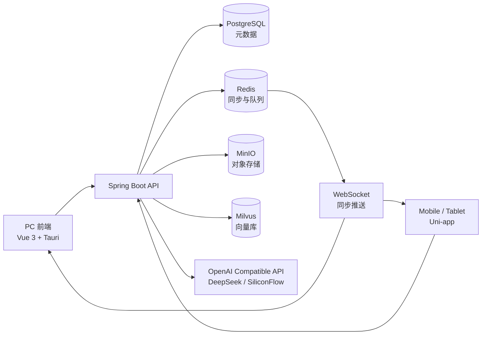
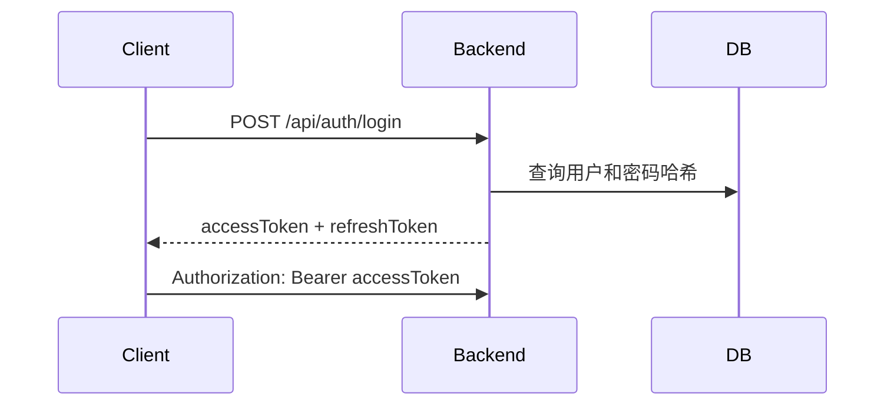
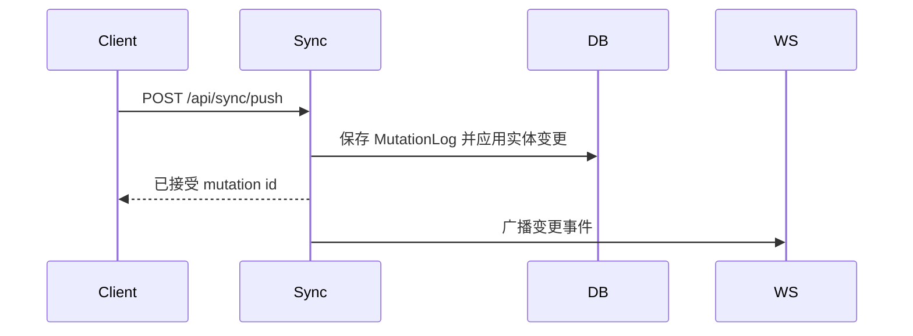
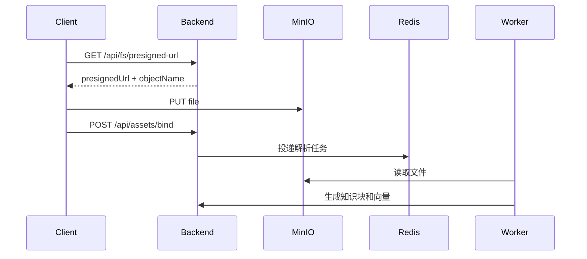

> [!WARNING]
> 本文档为历史归档，仅用于追溯需求、设计与项目演进。它不是 Auralis 当前实现、状态、接口或任务的依据。开发者与 AI Agent 禁止依据本文恢复旧实现、判断当前完成度或创建当前任务；请从 `docs/README.md` 进入现行文档体系。

# 系统架构设计

更新时间：2026-07-02

## 总体架构

## 技术选型

| 层级 | 技术 | 选择理由 |
| --- | --- | --- |
| PC 端 | Vue 3 + Vite + Tauri | 轻量桌面壳，避免 Electron 资源开销 |
| 移动端 | Uni-app + Vue 3 | 复用 Vue 技术栈，覆盖 H5 和多小程序目标 |
| 后端 | Spring Boot 3 + Java 21 | 稳定工程生态，适合集中式业务和 AI 编排 |
| ORM | MyBatis Plus | 简化 CRUD 和分页查询 |
| 同步 | Redis + WebSocket + MutationLog | 支持多端增量同步和事件通知 |
| 对象存储 | MinIO | 支持预签名直传和本地部署 |
| 向量库 | Milvus | 支持语义检索和 RAG |
| AI 编排 | LangChain4j | Java 原生 AI 编排，支持 OpenAI 兼容模型 |

## 模块划分

### PC 前端

- 负责重型学习工作流：学科空间、资产编排、Timeline、知识图谱、设置。
- 通过 HTTP API 和 WebSocket 与后端通信。
- 通过 Tauri 能力支持本地数据和桌面体验。
- 当前页面正在重构，路由守卫临时关闭，安全验收前必须恢复。

### Mobile / Tablet 前端

- 手机端偏快速捕获、复习和状态查看。
- 平板端偏大屏学习、手写、阅读、复习和专注。
- 当前 H5 构建通过，其他目标平台需要单独验收。
- 平板端页面正在重构，`pages.json` 是当前路由事实来源。

### 后端

- 统一鉴权和用户上下文。
- 维护知识块、任务块、资产和同步日志。
- 处理 AI 聊天、文档解析、任务提取、手写转换。
- 对接 PostgreSQL、Redis、Milvus、MinIO 和模型服务。

### 基础设施

- PostgreSQL 存储业务元数据。
- Redis 承担实时同步和 Redis Stream 队列。
- MinIO 存储用户上传文件。
- Milvus 存储向量数据。
- pgAdmin 提供本地数据库管理入口。

## 核心数据流

### 登录鉴权

### 本地优先同步

### 文件上传与解析

## 第三方服务接入

- DeepSeek：聊天模型。
- SiliconFlow：Embedding 模型。
- MinIO：对象存储。
- Milvus：向量数据库。
- Redis：缓存、消息、Stream 队列。
- PostgreSQL：主业务数据库。

## 当前架构风险

- PC 前端路由守卫临时关闭，未登录访问控制不能按正式状态验收。
- Mobile / Tablet 页面仍在重构，入口和导航需要最终收口。
- WebSocket 二次鉴权仍需联调验收。
- Milvus 多租户 Partition Key 设计需要和实际 collection schema 对齐。
- 文档解析链路仍需补充内容安全和对象校验。
- 缺少正式 CI/CD 和生产监控方案。
- `application-prod.yml` 配置口径需要和主配置中的 LangChain4j 配置统一。
