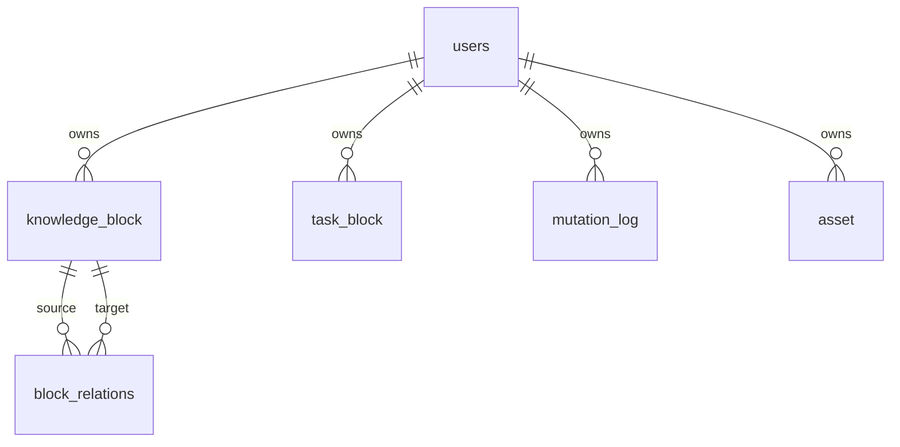

# Auralis 数据库与端侧数据契约

更新时间：2026-07-10

文档状态：现行，存在已登记的 DDL/Entity 漂移

权威范围：Server PostgreSQL 表、Entity 映射、同步字段、Mobile 本地表与数据生命周期

事实来源：`DbMigrationConfig.java`、`V2__add_encrypted_payload.sql`、Server Entity、Mobile `localDb.ts` 与笔记服务

## 数据源

| 数据源 | 作用 | 当前权威 |
| --- | --- | --- |
| PostgreSQL | 用户、知识块、任务、关系、mutation、资产 | Server 业务权威 |
| Mobile SQLite | 块、任务、学科、来源文件、mutation、同步元数据、Tablet 笔记 | 客户端离线副本/端侧专有数据 |
| MinIO | 文件对象 | 对象内容权威，元数据在 `asset` |
| Milvus | 向量 | 检索索引，不是业务正文唯一副本 |
| Redis | 缓存/同步辅助 | 不应成为唯一持久业务副本 |

## Server 关系

当前 DDL 主要由 `DbMigrationConfig` 在启动时执行，另有 `V2__add_encrypted_payload.sql`。仓库没有完整 Flyway/Liquibase 版本链。

## users

| 字段 | 类型 | 约束/语义 |
| --- | --- | --- |
| `id` | `VARCHAR(64)` | PK |
| `username` | `VARCHAR(128)` | UNIQUE, NOT NULL |
| `password` | `VARCHAR(256)` | NOT NULL，BCrypt 或待迁移旧明文 |

禁止把密码、hash 或 token 写入日志和文档示例。

## knowledge_block

| 字段 | 类型 | 语义 |
| --- | --- | --- |
| `id` | `VARCHAR(64)` | PK，跨端实体 id |
| `subject` | `VARCHAR(256)` | 学科显示值 |
| `title` | `VARCHAR(512)` | 标题 |
| `preview` | `TEXT` | 摘要/正文片段 |
| `time` | `VARCHAR(128)` | 当前为文本时间 |
| `source` | `VARCHAR(128)` | 来源 |
| `color` | `VARCHAR(64)` | 展示色 |
| `user_id` | `VARCHAR(64)` | 用户隔离 |
| `sync_version` | `BIGINT` | 默认 0，同步版本 |
| `is_deleted` | `BOOLEAN` | 默认 false，软删除 |
| `encrypted_payload` | `TEXT` | 可选 E2EE 业务字段载荷 |

## task_block

| 字段 | 类型 | 语义 | Entity 状态 |
| --- | --- | --- | --- |
| `id` | `VARCHAR(64)` | PK | 已映射 |
| `name` | `VARCHAR(256)` | 名称 | 已映射 |
| `subject` | `VARCHAR(256)` | 学科 | 已映射 |
| `desc` | `TEXT` | 描述 | 已映射 |
| `color` | `VARCHAR(64)` | 展示色 | 已映射 |
| `duration` | `INTEGER` | 分钟 | 已映射 |
| `load` | `VARCHAR(64)` | 负荷代码 | 已映射 |
| `load_text` | `VARCHAR(256)` | 负荷显示 | 已映射 |
| `status` | `VARCHAR(64)` | 状态 | 已映射 |
| `start_time` | `VARCHAR(128)` | 排期文本 | 已映射 |
| `user_id` | `VARCHAR(64)` | 用户隔离 | 已映射 |
| `sync_version` | `BIGINT` | 默认 0 | 已映射 |
| `is_deleted` | `BOOLEAN` | 默认 false | 已映射 |
| `encrypted_payload` | `TEXT` | 可选加密载荷 | 已映射 |
| `position` | `VARCHAR(256)` | 默认 `0`，排序 | **DDL 存在，`TaskBlock.java` 未映射** |

`position` 漂移是当前明确风险：Mobile 本地表和 Store 使用该字段，Server DDL 也创建该列，但 Server Entity/API 可能丢失值。修复时必须同时核对 Entity、Mapper、序列化、同步和客户端。

## block_relations

| 字段 | 类型 | 语义 |
| --- | --- | --- |
| `id` | `VARCHAR(64)` | PK |
| `source_id` | `VARCHAR(64)` | 源知识块 |
| `target_id` | `VARCHAR(64)` | 目标知识块 |
| `relation_type` | `VARCHAR(64)` | 关系类型 |

当前 Entity 没有 userId。访问关系时必须通过源/目标块归属或等价规则保证跨用户隔离；需要自动测试证明。

## mutation_log

| 字段 | 类型 | 语义 |
| --- | --- | --- |
| `id` | `BIGSERIAL` | PK，Server cursor |
| `client_id` | `VARCHAR(64)` | 客户端/设备 id |
| `user_id` | `VARCHAR(64)` | 用户隔离 |
| `entity_type` | `VARCHAR(64)` | `block` / `task` |
| `entity_id` | `VARCHAR(64)` | 业务实体 id |
| `action` | `VARCHAR(64)` | create/update/delete |
| `payload` | `JSONB` | 变更载荷 |
| `created_at` | `BIGINT` | 服务端顺序时间/记录值 |

索引：`idx_mutation_user_id(user_id, id)`，用于按用户和 cursor 增量读取。

## asset

| 字段 | 类型 | 语义 |
| --- | --- | --- |
| `id` | `VARCHAR(64)` | PK |
| `user_id` | `VARCHAR(64)` | 用户隔离 |
| `file_name` | `VARCHAR(512)` | 原始名 |
| `object_name` | `VARCHAR(1024)` | MinIO 对象名 |
| `file_size` | `BIGINT` | 客户端报告大小，待对象校验 |
| `content_type` | `VARCHAR(128)` | 客户端报告 MIME，待对象校验 |
| `status` | `VARCHAR(32)` | PENDING/PROCESSING/COMPLETED/FAILED |
| `subject` | `VARCHAR(256)` | 默认文档导入 |
| `created_at` | `BIGINT` | 创建时间 |

索引：`idx_asset_user_id(user_id)`、`idx_asset_status(status)`。

## Mobile 本地同步表

### sync_metadata

保存同步 cursor 和客户端元数据。cursor 必须来自 Server mutation id，不能由本地时间推断。

### local_mutations

保存待 push 的 `client_id`、`entity_type`、`entity_id`、`action`、`payload`、`created_at` 和同步状态。成功后当前实现删除已同步记录。

### knowledge_blocks / task_blocks

是 Server 实体的离线副本，并额外维护 `sync_status`。Mobile knowledge 本地字段还包括 `subject_id`、`source_file_id`、`tags`、`difficulty`、`mastery`、`review_at`、`related_block_ids`；这些字段并未全部进入当前 Server Entity，属于端侧扩展或待统一契约。

本地删除规则：

- 未同步新实体可直接 hard delete。
- 已同步实体标记 `is_deleted=1`、`sync_status=pending_delete`。
- 接收 Server delete mutation 后 hard delete 本地副本。

该流程必须与 Server 直接 DELETE 和冷启动行为联合测试。

### subjects / source_files

保存端侧学科与来源文件信息。当前 Server 没有对应完整 CRUD 契约，不能假设已跨端同步。

## tablet_notes

| 字段 | 类型 | 语义 |
| --- | --- | --- |
| `id` | `TEXT` | PK；文件批注可使用组合 id |
| `mode` | `TEXT` | 批注、学科手写、无限画布等模式 |
| `subject_id` | `TEXT` | 可空学科 |
| `asset_id` | `TEXT` | 可空资产 |
| `title` | `TEXT` | 标题 |
| `data` | `TEXT` | 序列化 `NoteDocument` |
| `updated_at` | `TEXT` | 更新时间 |

该表当前仅端侧保存，不进入 Server API 和同步。`data` 包含 pages、strokes、viewport、background 等模型内容。

## 同步不变量

- Server 必须覆盖 mutation 的 userId。
- 每个用户只读取自己的实体和 cursor。
- `sync_version` 用于版本比较，不能由客户端任意回退。
- 已删除实体不得出现在冷启动的有效数据集合。
- 重复 push 应具备幂等或可诊断行为。
- E2EE 开启时，加密载荷与明文字段的权威规则必须统一。

## 迁移与回滚要求

- 新字段必须同时更新 DDL/迁移、Entity/Mapper、API、同步、客户端和本文档。
- 生产前应引入单一版本化迁移工具，并明确现有程序化 DDL 的接管方式。
- 迁移前备份；回滚必须说明数据是否可逆。
- 禁止直接在生产手改表后只更新文档。

## 当前数据风险

- `position` DDL/Entity 漂移。
- Mobile 扩展知识字段未进入 Server 契约。
- `BlockRelation` 没有直接 userId 字段。
- 迁移机制混合且无完整版本链。
- 删除与冲突语义缺自动化覆盖。
- Tablet notes 无远程备份、导入导出或同步。
