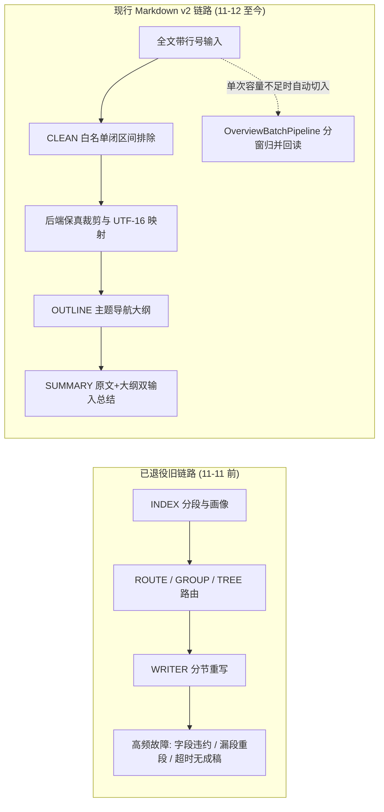

# Auralis AI 链路与交互体验调优报告

更新时间：2026-11-24

文档状态：现行专题总结

权威范围：Overview 53 轮历史实验调优结论、Token 输入估算与动态输出预算规划、Chat Agent Loop 治理及跨端流式吐字调速的量化对照、落地参数与残余开放边界

事实来源：当前源码（`OverviewMarkdownPipeline`、`OverviewBatchPipeline`、`OverviewBudgetPlanner`、`AiInputTokenEstimator`、`smoothStreamBuffer`）、[当前状态](Status.md)、[问题和审查](IssuesAndReview.md)、[后端模块](../modules/Backend.md) 及 [Overview 实验归档](../archive/overview-experiments/README.md)、[设计与实施方案归档](../archive/design-and-plans/README.md)

> [!IMPORTANT]
> **证据边界声明**：本报告严格区分「实验样本实测」「离线回放」「自动化回归通过」与「全场景 / GUI / 真机业务验收」。历史实验结果仅证明指定样本、模型与提示词下的观测表现，不外推为任意长文或未知模型的普遍验收结论；所有现行参数均已逐一对照当前仓库源码核实。

---

## 一、核心调优成果总览

| 调优领域 | 调优前基线痛点 | 落地收敛方案 | 关键量化改善（样本 / 回放实测） | 当前状态 |
| --- | --- | --- | --- | --- |
| **Overview 流水线架构** | `INDEX → ROUTE → TREE → WRITER` 复杂 JSON 树频发字段违规、漏段/重段、超时与无成稿 | 收敛为 `CLEAN → OUTLINE → SUMMARY` Markdown v2，超容自动切入 `OverviewBatchPipeline` | 4 类真实文档 12 次调用全 `200/stop` 零重试成稿；正式接口 PDF 16.5s / PPT 9.4s 完成 | 源码已落地；长文多批语义质量与 GUI 验收仍开放 |
| **原文清洗（CLEAN）** | 逐 chunk 混合导致 PPT 净排除为 0；逐块分类耗时高达 81.9s；开放式排除误删规则与承诺 | 五类白名单闭区间排除 + 显式保护边界（禁 `OTHER/NOISE/DUPLICATE`） | 手册误删清零，恢复 **1,166 UTF-16** 关键规则/例外/承诺；DOCX 恢复 **869 UTF-16**；单次输出降至 57–441 tokens | 源码已落地；存在重复漂移与混合行误删残留 |
| **Token 输入估算** | `UTF-8 bytes + framing` 较实际输入高估 **2.64–4.79 倍**（中位 4.06x），频繁卡死预算准入 | 统一 `unicode-category-v1` 静态分类计权 + 高风险片段字节回退 | 16 条跨模型（DeepSeek / MiMo）回放收紧至 **1.47–2.12 倍**（中位 **1.91x**），**0/16 低估** | 源码已落地；密集英文/代码/新模型需继续留出验证 |
| **动态输出预算规划** | 各阶段固定按模型上限预留 **393,216 tokens**，单次任务总预留动辄超 500K | 按阶段与材料规模算最低输出并加 **50% 裕量**，与 Gateway 共用同一输入估算 | 单阶段预留总量骤降 **85.9%～97.8%**（PDF CLEAN 525K → 74K，PPT 414K → 14K）；实测 0 截断，最高输出占比 14.8% | 源码已落地；正式 API 4 份样本验证通过 |
| **大纲与总结 Prompt** | PDF 大纲曾膨胀至 14,163 字（超总结本身）；单加篇幅压缩又导致范围泛化与脑补配对 | 统一上位议题 1–2 条大纲格式 + 两档长度软目标 + 原文事实限定强度约束 | 大纲缩减 **41.3%～87.8%**；PDF 正式总结 `7,848 → 3,394`，PPT `4,048 → 1,256` UTF-16，DBTG 限定恢复、映像脑补消除 | 源码已落地；手册例外遗漏与跨模型偏长待继续收敛 |
| **Chat Agent Loop** | 工具错参直接杀对话、长检索爆上下文、偶发空回复气泡、思考泄露内部工具名 | 错参有限自愈、12 轮/20 工具硬帽、确定性分层压缩、空 STOP 补答、思考脱敏与中文标签 | 定向协议与恢复回归全过；评估后明确保留只读工具串行，避免共享租约竞态 | 源码与自动化收口；真实 Provider 与跨端联调待验收 |
| **跨端流式吐字体验** | 网络停顿或高吞吐突发导致文字“一段一段猛冲”、过程区工具底部扎堆 | Delta-Time 5 段连续单调调速曲线 + 空池见底冷却复位 + 按字符预算交错披露 | PC（901 项）与 Mobile/Tablet（111 项）回归全过；消除高水位突发跳字与停顿猛冲 | 源码与自动化收口；真机与真实 Provider 流式待实测 |

---

## 二、Overview 文档总览体系调优（53 轮实验全景）

Overview 模块经历了从 2026-10-25 质量基线到 2026-11-11～13 共 53 轮集中实验与代码重构，形成了完整的架构演化与量化决策链条。

### 2.1 架构范式切换：为何彻底淘汰 JSON 树路由



2026-10-25 质量基线（[Overview 实验归档](../archive/overview-experiments/README.md)）首先暴露出旧链路的严重越界扩写问题（原解析仅到教材第 1 章局部，成稿却按目录扩写为大量未展开章节）。随后 2026-11-11 的 15 轮分段与路由实验集中检验了旧链路的多种变体，结果均无法兼顾协议可靠性与语义质量：

| 代表实验轮次 | 尝试方案 | 核心实测结果与失效模式 | 决策去向 |
| --- | --- | --- | --- |
| `20261111-four-stage` | 复用 INDEX → ROUTE → 树整理 → WRITER | PDF 重复覆盖段 `S23`，下游直接中止无成稿；PPT 写出 30 节仍需离线恢复 | 淘汰 |
| `20261111-group-first` | 先 GROUP 定小节再 TREE 绑定上位组 | PDF 产 22 叶且前置资料全误收；PPT 合并到 16 叶却错挂入课程安排 | 淘汰 |
| `20261111-route-raw / v2` | ROUTE 直接读完整原文段（不依赖段画像） | 频繁出现 `GROUP` 携带非法范围字段或漏段（漏 `S13`）被协议拒收 | 淘汰 |
| `20261111-route-split / v2 / v3` | 将 ROUTE 拆成 FILTER + ORGANIZE 两阶段 | PDF 仍因 `GROUP` 多余字段拒收或误收漏收；PPT 层级改善但叶数反弹（16→27） | 淘汰 |
| `20261111-v9-full` | 冻结材料运行 v9 INDEX/ROUTE/WRITER 与标题修正 | PDF 新 INDEX 两次 300s 超时无响应；冻结 INDEX 后 ROUTE 仍误纳六版前言、无成稿；PPT 仍残留课程简介（[report.md](../archive/overview-experiments/20261111-v9-full/data/report.md)） | 淘汰 |
| `20261111-stability` | 同输入同参数原样重复 ROUTE 两次 | PDF 两次均将六版前言（12,544 字）+ 预告（440 字，合占全文 28.8%）纳入正文；PPT 第 1 次漏 `S2` 被拒、第 2 次通过（[report.md](../archive/overview-experiments/20261111-stability/data/report.md)） | 确认旧架构稳定性不可控 |
| `20261111-whole-text-route` | 跳过 INDEX，完整原文直接出 Markdown 目录 | PPT 覆盖 5/5 主线通过；PDF 覆盖 3/3 主线但误把目录当正文 | 催生“先清理、后 Markdown”新路线 |

**关键结论**：让模型同时承担“全局文档阅读 + 辅文筛选 + 严格层级树 JSON 编排 + 全覆盖段号校验”，任务耦合度过高；单靠堆提示词或拆分 ROUTE 阶段无法稳定闭合。因此于 2026-11-12 彻底退役旧链（[Markdown 替换实施记录](../archive/design-and-plans/plans/overview/2026-11-12-overview-markdown-replacement.md)），改由**轻量行号排除（CLEAN）+ 纯 Markdown 大纲/总结（OUTLINE/SUMMARY）**解耦结构与内容职责。

---

### 2.2 原文清洗（CLEAN）策略演进

为解决“未清洗原文直接生成大纲导致 PDF 越界扩写并在 8192 输出截断”（`20261112-outline-summary`），在 4 份异构样本（教材 PDF 45,087 字、课件 PPT 7,449 字、操作手册 PDF 13,981 字、项目计划书 DOCX 17,775 字）上系统对照了五类清洗范式：

| 清洗范式 | 代表轮次 | 优点 | 暴露的缺陷 | 结论 |
| --- | --- | --- | --- | --- |
| 全文自由划分用途区间 | `20261112-classification` | 去除大部分教材前置内容 | PPT 行政信息残留；DOCX 独立项目摘要被误删 | 淘汰 |
| 按既有检索 chunk 分类 | `20261112-classification-chunks` | 无需额外切块 | chunk 重叠且混杂多种用途，PPT **净排除为 0** | 淘汰 |
| 按已有块 ID 全量贴标签 | `20261112-classification-blocks` | 救回 DOCX 独立摘要，改善 PPT 行政筛除 | DOCX 474 块需输出 **3,868 tokens / 81.9s**；加正反例（`examples`）或顺序提示（`sequence`）反而引发 PPT 课程简介回归为正文；二阶段复核（`audit`）产生范围偏移（[report.md](../archive/overview-experiments/20261112-classification-blocks/data/report.md)） | 淘汰 |
| 开放式行号排除区间 | `20261112-exclusion-ranges` | 输出极短、不依赖外部切块 | 模型自行按“去重/版面”擅自删文，误删操作手册实质规则与承诺 | 需收紧边界 |
| **五类白名单排除 + 保护边界** | `20261112-exclusion-constrained` | 仅允许 5 类明确枚举，显式保护摘要/规则/例外/承诺与混合行；单次输出 57–441 tokens（3.8–16.9s） | 手册误删清零（恢复 **1,166 UTF-16**）、DOCX 恢复 **869 UTF-16**；但仍残留教材 440 字篇首预告与 DOCX L17 混合行误删（[report.md](../archive/overview-experiments/20261112-exclusion-constrained/data/report.md)） | **落地现行生产** |

**稳定性复测发现（[20261112-exclusion-constrained-repeat](../archive/overview-experiments/20261112-exclusion-constrained-repeat/data/report.md)）**：逐字节复用同一 wire request 重跑 4 份样本（共 90,719 tokens）：
- **手册与 DOCX**：两次排除范围完全一致，手册关键规则保护稳定，但 DOCX 的 L17（摘要+目录合并 OCR 行）仍被强贴 `TOC` 删除，证明提示词级的“混合行保护”尚不能 100% 约束模型。
- **教材 PDF 与 PPT**：出现范围漂移——教材复跑回漂 **538 UTF-16** 全书内容提要（`L13–32`），PPT 多保留 10 字目录行（`L118`）。

---

### 2.3 输入 Token 估算与动态输出预算调优

这是本轮调优中**工程确定性最高、资源收益最直观**的突破，分三步完成闭环：

#### 第一步：官方 Tokenizer 精确对齐基线（`20261112-input-budget`）
在 DeepSeek `V4.1-Flash-1017` 固定修订（`08c8657f`）上离线复算 10 条请求（8 条 Markdown + 2 条可重建 CLEAN JSON）：
- 加入 `response_format={"type":"json_object"}` 对应的 22 tokens 模板开销后，**10/10 条本地计数与供应商 `usage.prompt_tokens` 差值均为 0**（[report.md](../archive/overview-experiments/20261112-input-budget/data/report.md)）。
- 量化暴露旧 `legacy-bytes` 虚高程度：DeepSeek Markdown 高估 **4.02–4.79 倍**，正式账本高估 **3.01–4.87 倍**，MiMo 历史记录高估 **2.64–4.29 倍**。

#### 第二步：通用静态估算器收敛与跨供应商反证（`20261112-input-budget-generic` → `budget-java-replay`）
在 DeepSeek（10 条）与 MiMo（6 条）共 16 条历史请求上对照三种方案（[report.md](../archive/overview-experiments/20261112-input-budget-generic/data/report.md)）：

| 输入估算方案 | 估算 / 实际比范围 | 中位数 | 低估样本 | 评价 |
| --- | ---: | ---: | ---: | --- |
| 旧方案：`UTF-8 bytes + framing` | 2.64 – 4.79x | 4.06x | 0 / 16 | 严重虚高，触发无谓额度拒收与提前分批 |
| 过渡方案：既有 Unicode 权重 ×2 + 统一结构预留 | 1.59 – 3.05x | 2.48x | 0 / 16 | 仍偏宽松 |
| **现行方案：`unicode-category-v1` 静态分类 + 高风险字节回退** | **1.47 – 2.12x** | **1.91x** | **0 / 16** | DeepSeek 1.70–2.12x，MiMo 1.47–1.91x，Java 探针与 Python 候选逐条差值 0 |

> [!WARNING]
> **跨供应商拟合反例**：如果按 DeepSeek 最大实际/估算比拟合缩放系数并加 10% 裕量，去预测同原文的 MiMo CLEAN 请求会直接发生**低估**（PDF 估 42,863 < 实际 45,084；PPT 估 7,947 < 实际 7,957）。因此最终放弃“按供应商拟合/白名单”和引入重型本地 JNI tokenizer，选择零外部依赖、跨模型可复现的 `unicode-category-v1`。

**现行源码落地参数**（[AiInputTokenEstimator.java](../../Auralis-Server/src/main/java/com/auralis/app/ai/usage/AiInputTokenEstimator.java)）：
- **码点权重**（每 100 单位）：CJK（汉字/假名/谚文）`1.25`、拉丁字母 `0.60`、十进制数字 `0.70`、空白字符 `0.40`、常见标点 `0.95`。
- **字节回退防低估规则**：围栏代码块（`` ``` `` / `~~~`）、结构符号密集行（符号数 ≥ 4 且占比 ≥ 1/8）、长度 ≥ 24 的不透明串（Base64/Token/长路径）、补充平面字符（`≥ 0x10000`）与未覆盖脚本均自动按局部 UTF-8 字节数计费。
- **固定结构裕量**：每请求 `+64`、每条消息 `+8`、启用结构化 JSON 再 `+32`。

#### 第三步：阶段动态输出规划与正式接口实测
现行 [OverviewBudgetPlanner.java](../../Auralis-Server/src/main/java/com/auralis/app/ai/OverviewBudgetPlanner.java) 按阶段计算最低输出需求 `min`，再附加 **50% 目标裕量**（`target = min + ceil(min / 2)`），受模型上下文净余量、模型最大输出及可选配置上限共同约束：

| 阶段 | 最低输出公式（`OverviewBudgetPlanner.minimumOutputTokens`） | `materialSize` 含义 |
| --- | --- | --- |
| `CLEAN` / `CLEAN_BATCH` | `256 + 64 × ceil(size / 32)` | 原文物理行数 |
| `OUTLINE` | `512 + 256 × ceil(size / 2,000)` | 清理后字符数 |
| `OUTLINE_MAP` / `OUTLINE_MERGE` | `min(4096, 768 + 256 × ceil(size / 4,000))` | 窗口/待归并文本字符数 |
| `SUMMARY_MAP` | `min(4096, 1024 + 256 × ceil(size / 4,000))` | 窗口文本字符数 |
| `SUMMARY` | `512 + 2 × size` | `min(清理后字符数, 软预算上限 1800 或 5000)` |
| `SUMMARY_MERGE` | `min(6144, 1024 + size / 2)` | 待归并摘要规模 |

**四份真实资料正式后端实测账本汇总**（`deepseek-flash`，均来自 [unified-budget-formal](../archive/overview-experiments/20261112-unified-budget-formal/data/report.md) 与 [docx-manual-review](../archive/overview-experiments/20261112-docx-manual-review/data/report.md)）：

| 资料 | 三阶段总预留（新方案） | 三阶段实际结算总计 | 实际输入 / 实际输出 | 耗时 | 截断 / 残留预留 |
| --- | ---: | ---: | ---: | ---: | --- |
| 数据库教材 `1.pdf`（45,087 字） | 147,929（旧单阶段超 450K） | **66,291** tokens | 64,040 / 2,251 | **16.49 秒**（SSE 端到端） | 0 截断 / 0 残留 |
| 编译原理 `chap01.pptx`（7,449 字） | 37,384（旧单阶段超 407K） | **15,783** tokens | 14,609 / 1,174 | **9.38 秒**（SSE 端到端） | 0 截断 / 0 残留 |
| 学生操作手册 PDF（13,984 字） | 83,335 | **38,544** tokens | 35,253 / 3,291 | **20.12 秒**（阶段合计） | 0 截断 / 0 残留 |
| 星校园计划书 DOCX（17,775 字） | 85,945 | **36,330** tokens | 32,834 / 3,496 | **21.47 秒**（阶段合计） | 0 截断 / 0 残留 |

---

### 2.4 大纲与总结 Prompt 质量调优

#### 1. 大纲结构压缩（[20261112-outline-format-trial](../archive/overview-experiments/20261112-outline-format-trial/data/report.md)）
早期正式版本中，PDF 大纲一度膨胀至 **14,163 UTF-16（18 标题 / 263 列表项）**，甚至比总结更长（[pdf-budget-retest](../archive/overview-experiments/20261112-pdf-budget-retest/data/report.md)）。通过移除序号、禁用三级标题与加粗标签、明确要求上位议题 `##` 下仅保留 1–2 条范围短语（不展开定义与例子），大纲体量与输出消耗均显著收敛：

| 资料（同清理文本，MiMo 实测） | 旧正式大纲（UTF-16 / 列表项） | 调优后大纲（UTF-16 / 列表项） | 字符缩减 | 输出 Token 变化 |
| --- | ---: | ---: | ---: | ---: |
| 编译原理 PPT | 935 / 18 | **549 / 15** | **-41.3%** | 723 → 377 |
| 学生操作手册 PDF | 3,370 / 61 | **411 / 9** | **-87.8%** | 1,146 → 274 |
| 星校园计划书 DOCX | 1,676 / 39 | **622 / 14** | **-62.9%** | 1,059 → 405 |

#### 2. 总结“压长度 vs 守事实”两阶段调优
单变量消融实验揭示了长文档总结调优的核心权衡：

| 迭代阶段与轮次 | 改动内容 | PDF 总结（UTF-16） | PPT 总结（UTF-16） | 事实准确性与质量观测 |
| --- | --- | ---: | ---: | --- |
| 早期正式版（`pdf-budget-retest`） | 旧大纲 + 旧总结提示 | 13,272 | 4,048 | 逐项抄录功能清单、人物年份与学生记录样本 |
| 仅压缩大纲（`compressed-pdf-ppt`） | 压缩大纲输入现行 SUMMARY | 9,602（25.1s） | 2,303（6.9s） | 标题减少但正文仍偏长（占清理原文 43.7% / 35.8%） |
| **加长度软目标**（`summary-compression`） | 仅改 SUMMARY system，加软目标（PDF 3000–5000 / PPT 1200–1800） | **3,729**（**-61.2%**，13.3s） | **1,127**（**-51.1%**，4.5s） | **暴露压缩副作用**：省略了 DBTG 系统限定（泛化为整个网状模型），并自行脑补原文未展开的“两级映像与物理/逻辑独立性配对” |
| **补事实范围规则**（`summary-scope`） | 在首段追加“保留限定对象/系统/条件，不从常识推导因果或对应” | 5,175（17.0s） | 1,341（4.8s） | **准确度显著回升**：DBTG 限定恢复，未展开映像配对幻觉消失，PPT 10.0/60.0 两例不再混串 |
| **现行正式落盘**（`unified-budget-formal`） | 联合预算 + 压缩大纲 + 事实边界 + 动态两档软目标 | **3,394**（v3: 7,848） | **1,256**（v3: 4,048） | 两份均落在软目标内，DBTG 限定与三级模式边界保持准确 |

**现行生产落地策略**（[OverviewMarkdownPipeline.java](../../Auralis-Server/src/main/java/com/auralis/app/ai/OverviewMarkdownPipeline.java) & [OverviewBatchPipeline.java](../../Auralis-Server/src/main/java/com/auralis/app/ai/OverviewBatchPipeline.java)）：
- 按清理后正文长度自动分档：`≤ 10,000` 字符使用软目标 `1200～1600`（预算上限 1,800）；`> 10,000` 字符使用 `3000～4000`（预算上限 5,000）。
- 超容量自动分批采用核心窗口 `32,000` 字符、前后重叠 `300` 字符、单行切分阈值 `4,000` 字符，并在归并大纲后按窗口路由回读原文生成总结（11-13 本机 32,768 token 上限实测中，`1.pdf` 自动分批 8 次派发成功，学科总览保存回读一致）。

---

## 三、Chat Agent 稳定性与跨端流式体验调优

### 3.1 Chat Agent Loop 容错、收敛与上下文治理
根据 [Chat Agent Loop 演进记录](../archive/design-and-plans/plans/ai/2026-11-04-chat-agent-loop-evolution.md) 与 [后端模块](../modules/Backend.md) 核对，Chat 协议 1 完成了 7 项关键治理调优：

1. **工具错误分层收敛**：授权范围与资料 revision 未变化时，片段 ID 错误或越界 `sourceIds` 归类为可限次自愈的 `native tool result`（`CHAT_TOOL_ARGUMENT_INVALID`），不直接杀死对话；真实越权、版本变更、预算耗尽与取消保持硬终止。
2. **迭代与工具硬帽**：默认及硬上限收敛为 **12 轮模型调用 / 20 次工具执行**，最后允许轮禁止新调工具强制收尾；`list_sources` 分页上限 20 条，`search.sourceIds` 仅允许缩窄会话冻结范围。
3. **确定性分层上下文压缩**：`ChatEvidenceHistoryProjector` 仅对请求投影中的较早成功工具副本去重/缩短，保留原始 evidence 账本、受保护上下文与工具调用/结果配对，不额外调用摘要模型；无 fit 时在派发前给出分维度安全诊断。
4. **防空白气泡**：无有效正文、展示组件或题卡的空 STOP，在剩余额度内最多自动追加 1 次 continuation，二次仍空则给出明确可见提示。
5. **`UNKNOWN` 显式恢复与范围绑定**：新会话首次 turn 在事务内绑定 `SUBJECT / SELECTED / AUTO` 范围（跨范围返回 `409 CHAT_SCOPE_CONFLICT`）；异常中断产生的 `UNKNOWN` 不再靠超时盲目退款或自动重派，改由 `attempt-scoped` 显式恢复接口按固定锁序结算释放。
6. **只读工具并发评估结论（明确不做）**：第 8 步评估指出当前 usage Scope 共享单一 active reservation/heartbeat 指针，且 `search` 产生真实 embedding 计费、工具执行带顺序自愈语义；在缺乏逐工具耗时收益实测前，**保留串行执行**以防止引入竞态与额外复杂度。
7. **思考过程脱敏与工具语义化（2026-11-19）**：在 `ChatAgentOrchestrator.SYSTEM_PROMPT` 与 `ChatToolPresentation` 中收敛思考表达、屏蔽内部工具名（如 `list_sources`、`read_source_overview`），全端统一输出中文工具名与安全摘要 `label`，并统一交错过程时间轴。

### 3.2 跨端流式吐字平滑调速调优（2026-11-20）
针对实测中大模型 SSE 网络突发/停顿导致的“文字一段一段猛冲”、过程区工具底部扎堆与 settling 期重复重排问题，PC（[smoothStreamBuffer.ts](../../Auralis-PC/src/services/smoothStreamBuffer.ts)）与 Mobile/Tablet（[smoothStreamBuffer.ts](../../Auralis-Mobile/src/utils/smoothStreamBuffer.ts)）统一落地了 **Delta-Time 连续单调蓄洪缓冲器**：

- **刷新率解耦与防跳字保护**：以 `performance.now()` 计算秒级增量并封顶单帧 `deltaSeconds ≤ 80ms`，消除 60Hz/120Hz/240Hz 屏速差及切后台唤醒瞬跳。
- **双轨默认调速参数**：
  - **正文轨道**：`minSpeed = 14`、`baseSpeed = 28`、`maxSpeed = 105`、`finishSpeed = 58`（字/秒），指数阻尼系数 `damping = 3.8`。
  - **思考轨道**（见 [Status.md](Status.md)）：`18 / 38 / 125 / 76`（字/秒），`damping = 4.2`。
- **5 段连续单调目标速率函数**（`computeSmoothStreamTargetSpeed`）：
  - `remaining ≤ 1`：`minSpeed`（低水位保底拉伸，覆盖 200–300ms 网络空窗）
  - `1 < remaining ≤ 12`：在 `minSpeed → baseSpeed` 间线性平滑过渡
  - `12 < remaining ≤ 80`：`baseSpeed + (remaining - 12) × 0.45`
  - `80 < remaining ≤ 240`：`baseSpeed + 30.6 + (remaining - 80) × 0.35`
  - `remaining > 240`：`baseSpeed + 86.6 + (remaining - 240) × 0.25`（受 `maxSpeed` 封顶）
  - 流结束排空态：`min(maxSpeed, max(finishSpeed, baseSpeed + remaining × 0.55))`
- **关键防猛冲机制**：蓄水池见底挂起（`remaining === 0`）、`flush` 或 `reset` 时，**强制复位 `currentSpeed = minSpeed`**，避免下一波突发网络包到达时沿用上一波高速度瞬间倾泻；配合按当前已披露字符预算交错渲染时间轴与 `H5 fetch ReadableStream` 真流式接收，打通全端顺滑体验。

---

## 四、已被实验证伪的反模式与工程经验

1. **禁止让单次 JSON 路由同时做“筛选 + 树构建 + 全段覆盖”**：在多份真实教材与课件上，模型极易在字段约束与段号完整覆盖间顾此失彼，且同输入复跑不稳定；应把轻量行号清理与纯 Markdown 生成解耦。
2. **禁止迷信“加正反例 / 加二阶段复核”一定提效**：在清洗分类实验中，追加 6 个正反例（`classification-examples`）和顺序提示（`classification-sequence`）反而引发 PPT 课程简介回归成正文，二阶段复核（`classification-audit`）引入范围偏移。任何提示词改动必须用冻结原文做单变量对照。
3. **禁止用单供应商实测系数反推其他供应商估算上限**：跨供应商留出实测已证明，以 DeepSeek 拟合 +10% 裕量会直接低估 MiMo 输入（实报超估算）；预算准入估算必须采用模型无关的保守静态规则，并把未知结构回退到 UTF-8 bytes。
4. **禁止只做篇幅压缩而不加事实限定护栏**：仅加入字数软目标可立竿见影压低 50%～60% 篇幅与近半耗时，但模型会通过“抹去适用条件/系统限定”和“用常识补全未展开概念”来凑简洁，必须同步施加事实强度约束。
5. **禁止把 HTTP 200 / `finish_reason=stop` / Schema 校验通过等同于内容质量通过**：多轮实验（如 `production-pipeline-live`、`docx-manual-review`）表明，全部调用 200/stop 且通过协议校验时，仍可能存在混合行误删、核心规则例外遗漏或大纲超条数问题。
6. **禁止在流式缓冲见底后保留历史高速度**：高吞吐结束后若未在空池停顿时把 `currentSpeed` 冷却回 `minSpeed`，后续新批次到达时会立刻整段弹出，制造强烈卡顿错觉。
7. **禁止缺乏实测收益时盲目引入工具并发或外部重型依赖**：Chat 只读工具并发与 Java 本地 JNI tokenizer 均经过可行性评估后主动克制，优先保证账本一致性、部署简洁性与稳定性。

---

## 五、尚未收敛的残余问题与下一阶段调优建议

| 优先级 | 残余问题 | 已有实测证据 | 建议的下一轮定向动作 | 关闭条件 |
| --- | --- | --- | --- | --- |
| **P1** | **CLEAN 重复漂移与混合行误删** | `exclusion-constrained-repeat` 复跑仅 2/4 一致；教材回漂 538 字提要、残留 440 字预告；DOCX L17 摘要+目录混合行仍被 `TOC` 误删 | 优先排查上游解析阶段为何产生“摘要+目录聚合单行”（从解析切分根治混合行，而非仅靠 Prompt 兜底）；对高风险长文档评估是否保留 CLEAN trace 抽检 | 4 份基准文档多轮重复采样中无核心正文/混合行误删，且范围漂移处于可接受阈值 |
| **P1** | **总结中适用条件与规则例外遗漏** | `production-pipeline-live` 与 `docx-manual-review` 中，手册总结均遗漏“除教师团队成员”学籍校验例外；MiMo 下 DOCX 总结仍占原文 56.4% | 对含强约束/例外条款的制度/手册类文本补充定向摘要对照实验，比较 DeepSeek / MiMo 在相同软目标下的例外保留率与压缩率 | 规则类样本人工逐条核对无关键例外遗漏，且长度稳定落在软目标内 |
| **P1** | **大纲跨文档条数约束不稳定** | `outline-format-trial`、`unified-budget-formal` 与 `docx-manual-review` 中，PPT/手册/计划书均存在部分主题超过 1–2 条（达 3–7 条） | 评估在业务体验上“硬控 1–2 条”是否合理，或在 Prompt 中明确上限并抽查长文档多批 `OUTLINE_MERGE` 的主题密度 | 覆盖短课件、教材与长计划书的跨样本抽查达标 |
| **P1** | **估算器长尾样本覆盖不足** | 16 条预算回放仅来自 2 份文档与 2 个模型，未覆盖纯代码、密集英文、复杂 JSON/OCR 噪声与新模型 | 利用现行 Gateway shadow 日志离线汇总真实线上 `estimated / actual` 分位数，重点监控最坏低估而非均值；仅在扩大留出集后再评估是否微调权重 | 扩展样本集（含密集英文、代码、多模型）留出验证仍保持零低估 |
| **P1** | **真实运行态与跨端业务验收未闭环** | 11-19～20 Chat 思考脱敏、流式平顺调速及多端对齐以自动化测试为主；Overview 真实取消/代理断连/跨实例去重仍待核实 | 在真实已登录态、真实 Provider 与桌面/手机/平板真机上按 [问题和审查](IssuesAndReview.md) 逐项补齐端到端现场证据 | 留存真实 Provider/真机/断流恢复与多批复杂文档的人工核对记录 |

---

## 六、关键源码与实验报告索引

### 现行核心源码
- [OverviewMarkdownPipeline.java](../../Auralis-Server/src/main/java/com/auralis/app/ai/OverviewMarkdownPipeline.java) — CLEAN / OUTLINE / SUMMARY 现行提示词、两档篇幅软目标与自动分批入口
- [OverviewBatchPipeline.java](../../Auralis-Server/src/main/java/com/auralis/app/ai/OverviewBatchPipeline.java) — `32,000` 字符窗口、分窗清理、大纲归并路由与回读总结实现
- [OverviewBudgetPlanner.java](../../Auralis-Server/src/main/java/com/auralis/app/ai/OverviewBudgetPlanner.java) — 各阶段最低输出公式与 50% 裕量规划器
- [AiInputTokenEstimator.java](../../Auralis-Server/src/main/java/com/auralis/app/ai/usage/AiInputTokenEstimator.java) — `unicode-category-v1` 通用输入估算器与高风险字节回退
- [smoothStreamBuffer.ts (PC)](../../Auralis-PC/src/services/smoothStreamBuffer.ts) · [smoothStreamBuffer.ts (Mobile/Tablet)](../../Auralis-Mobile/src/utils/smoothStreamBuffer.ts) — 跨端连续单调流式吐字缓冲器

### 代表性实验与治理证据
- [Overview 实验总索引 (53 轮)](../archive/overview-experiments/README.md) · [rounds.json](../archive/overview-experiments/rounds.json)
- 旧架构证伪：[20261111-v9-full](../archive/overview-experiments/20261111-v9-full/data/report.md) · [20261111-stability](../archive/overview-experiments/20261111-stability/data/report.md)
- 清洗对照：[20261112-classification-blocks](../archive/overview-experiments/20261112-classification-blocks/data/report.md) · [20261112-exclusion-constrained](../archive/overview-experiments/20261112-exclusion-constrained/data/report.md) · [20261112-exclusion-constrained-repeat](../archive/overview-experiments/20261112-exclusion-constrained-repeat/data/report.md)
- 预算校准与正式实测：[20261112-input-budget](../archive/overview-experiments/20261112-input-budget/data/report.md) · [20261112-input-budget-generic](../archive/overview-experiments/20261112-input-budget-generic/data/report.md) · [20261112-budget-java-replay](../archive/overview-experiments/20261112-budget-java-replay/data/report.md) · [20261112-budget-live](../archive/overview-experiments/20261112-budget-live/data/report.md) · [20261112-unified-budget-formal](../archive/overview-experiments/20261112-unified-budget-formal/data/report.md) · [20261112-docx-manual-review](../archive/overview-experiments/20261112-docx-manual-review/data/report.md)
- 大纲与总结 Prompt 消融：[20261112-outline-format-trial](../archive/overview-experiments/20261112-outline-format-trial/data/report.md) · [20261112-compressed-pdf-ppt](../archive/overview-experiments/20261112-compressed-pdf-ppt/data/report.md) · [20261112-summary-compression](../archive/overview-experiments/20261112-summary-compression/data/report.md) · [20261112-summary-scope](../archive/overview-experiments/20261112-summary-scope/data/report.md) · [20261112-production-pipeline-live](../archive/overview-experiments/20261112-production-pipeline-live/data/report.md)
- Chat 治理与现行状态：[2026-11-04-chat-agent-loop-evolution.md](../archive/design-and-plans/plans/ai/2026-11-04-chat-agent-loop-evolution.md) · [Status.md](Status.md) · [IssuesAndReview.md](IssuesAndReview.md)
