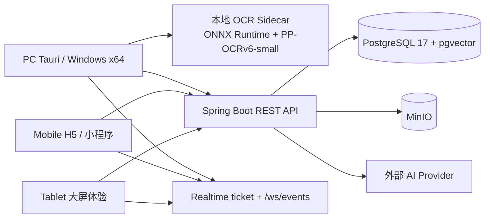
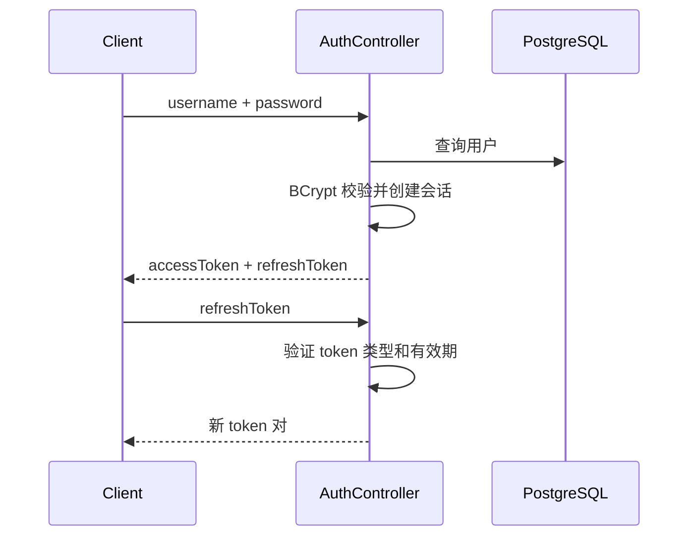
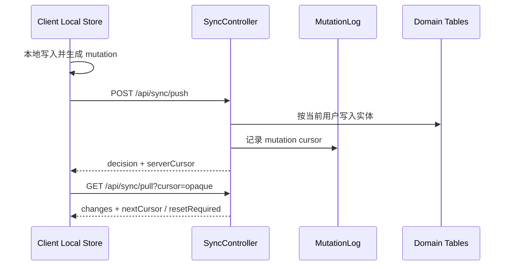
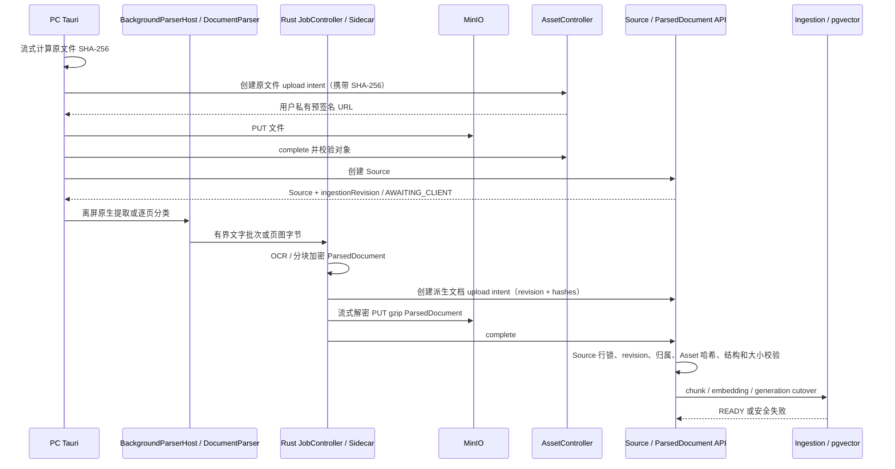

# Auralis 系统架构

更新时间：2026-08-24

文档状态：现行

权威范围：系统边界、组件关系、关键数据流、信任边界与架构风险

事实来源：当前 PC/Mobile/Server 代码、应用配置与 Docker Compose

## 总体结构



PC 和 Mobile/Tablet 是独立客户端工程。PC 的发布目标为 Windows x64 Tauri，PC Web 只保留内部开发用途；Mobile 与 Tablet 共用 Uni-app 工程和部分 Store/API/服务，但使用不同页面集合和布局。Server 是业务与 AI 中枢；客户端不得直接连接 PostgreSQL、pgvector、MinIO 或读取服务端 AI 密钥。PC 本地 OCR 只生成计划中的 ParsedDocument，不改变服务端对用户归属、索引和检索范围的权威。

## 组件边界

### PC

- Vue Router 管理 7 条当前路由。
- Pinia 管理账号、知识块、任务、学科、同步、聊天和设置。
- API 层封装鉴权、同步、资产、统计和 AI。
- Tauri 提供桌面容器与 SQL 插件能力。
- 已批准但尚未实现的 AI 阅读目标在 Vue/WebView 内使用单实例离屏 `BackgroundParserHost` 串行承载 Office renderer，在 Rust 中管理任务、分块加密缓存、流式上传和长驻 Windows x64 OCR Sidecar；Vue 不获得通用 Shell 权限。

详细实现见 [PC 模块](../modules/FrontendPC.md)。

### Mobile / Tablet

- `pages.json` 管理手机与平板页面；微信通过条件编译只包含启动页和手机页面。
- Pinia 管理账号、块、任务、学科、同步、设备、布局和设置。
- services 管理本地数据库、手写引擎、笔记模型和仓库。
- Tablet 手写笔记由 feature flag 控制入口。

详细实现见 [Mobile / Tablet 模块](../modules/FrontendMobileTablet.md)。

### Server

- Spring Modulith 业务模块提供 REST/SSE 协议、领域服务和模块边界。
- Spring Security、JWT access token 和 refresh rotation 管理认证会话。
- Spring Data JPA + Flyway 管理业务数据；pgvector JDBC repository 管理 1024 维向量和 HNSW 检索。
- AssetStoragePort 连接 MinIO；AI Provider port 连接允许名单内的 OpenAI-compatible 服务。
- Realtime 使用一次性短期 ticket 建立 `/ws/events` 用户级事件连接。

详细实现见 [后端模块](../modules/Backend.md)。

### 基础设施

- PostgreSQL 17 + pgvector：用户、领域资源、同步、AI 会话、RAG chunk 与向量。
- MinIO：用户 Asset 对象，以及计划中的私有 ParsedDocument 派生对象。
- Spring Boot：REST、SSE、Realtime、摄入 worker 与 Provider 编排。
- PC Tauri：端侧 SQLite、受控本地解析与计划中的 OCR Sidecar。

正式 MSI 中 Sidecar 可执行文件使用 Tauri `bundle.externalBin`，OCR 模型、配置和许可证使用 `bundle.resources`；依赖和模型版本/哈希进入固定清单，运行时不下载。Sidecar 由 Rust 通过版本化 stdin/stdout 协议调用，不暴露本地端口，也不接受 Vue 提供的任意路径。

Redis、Milvus 和 etcd 属于已退役旧 Server 栈，不进入新后端目标拓扑。

## 信任边界

```text
用户输入 / 文件 / token
        ↓ 不可信
客户端请求封装
        ↓ Authorization / 参数校验
Spring Security + owner-scoped Controller
        ↓ 当前用户上下文
Service / Mapper / Storage / AI Provider
```

强制规则：

- 客户端传入的 userId、objectName、API key、base URL 和数据归属都不能直接信任。
- HTTP 受保护接口只接受 access token；refresh token 仅用于刷新端点。
- WebSocket 在握手、PING 和定时审计阶段验证 token。
- 所有用户数据查询和修改必须带当前用户边界。
- 外部文件内容和 AI 输出必须按不可信数据处理。

## 关键数据流

### 登录与刷新



客户端路由守卫只改善交互，不能替代 Server 的 access token 与 owner scope 校验。

### 本地优先同步



删除必须在直接 CRUD、mutation、pull 和冷启动之间保持软删除语义一致。目前该一致性仍是风险项。

### 文件上传与 AI 摄入

以下流程是 2026-08-23 已批准、2026-08-24 技术复核修订的目标，当前仍处于计划状态；实现与验收状态以 current 文档为准。



FILE Source 的目标链路由 PC 统一生成 ParsedDocument，服务端不执行图片或扫描 PDF OCR。Office 后台解析必须由已挂载的离屏 renderer 完成，不能假设 Rust 能直接调用浏览器 File Viewer。TEXT/URL Source 继续由服务端解析。ParsedDocument 是不进入普通 Sync 的私有派生对象；服务端以 Source `ingestionRevision` 仲裁多设备并发 complete，最新成功代可用于重新分块或重新 Embedding。完整设计见 [PC Tauri AI 辅助阅读全流程设计](../design/2026-08-23-pc-tauri-ai-assisted-reading-design.md)。

### WebSocket 生命周期

1. 已认证客户端调用无请求体的 `POST /api/realtime/ticket`；服务端从 Bearer JWT 的 `serverDeviceId` 解析当前设备，不信任客户端提交设备字段。
2. 服务端返回一次性短期 ticket 与 `/ws/events` 地址；数据库只保存 ticket hash。
3. 客户端通过 query ticket 或 `X-Realtime-Ticket` 握手，ticket 过期、重放、跨用户或设备不匹配时拒绝。
4. 领域事务提交后发布用户级 `SYNC_CHANGED` / `REVIEW_UPDATED` 事件；当前实现为进程内订阅，跨实例 Broker 尚未接入。

自动测试已覆盖 ticket hash、过期、一次性消费、设备归属和提交后事件桥；真实客户端与跨实例行为仍需联调。

## 配置模型

- `application.yml`：JPA/Flyway、上传、同步、Realtime、AI 摄入与 Provider 公共配置。
- `application-local.yml`：本地开发行为与可观察性。
- `application-prod.yml`：生产禁用 API 文档，并要求数据库、JWT、MinIO、CORS 与 Provider 等关键环境变量。
- Compose：PostgreSQL/pgvector、MinIO、后端和开发用途前端容器；前端容器不代表 PC Web 发布目标。

生产部署必须从环境变量注入数据库、JWT、MinIO 和 AI 凭据，不能沿用开发默认值。

## 数据权威与缓存

| 数据 | 权威位置 | 客户端角色 |
| --- | --- | --- |
| 用户账号 | PostgreSQL | 保存 token 与最小用户状态 |
| 知识块、任务块 | PostgreSQL + 本地副本 | 离线操作、mutation、增量同步 |
| mutation cursor | Server mutation_log | 客户端保存 last cursor |
| 文件对象 | MinIO | 上传、展示、引用 objectName |
| 资产元数据 | PostgreSQL asset | 客户端显示状态和学科归属 |
| RAG chunk 与向量 | PostgreSQL `source_chunks` + pgvector | 不直接持久化到客户端 |
| ParsedDocument（计划中） | 服务端私有对象 + 元数据；本地仅在接收前以 keyring 主密钥的分块 AES-GCM envelope 暂存 | PC 解析、断点恢复和 Rust 流式上传，服务端确认后删除本地正文 |
| Tablet 手写笔记 | 端侧 `tablet_notes` | 当前不进入 Server 同步 |

## 当前架构风险

| 风险 | 证据 | 架构影响 |
| --- | --- | --- |
| 本地 OCR 尚未实现 | 2026-08-24 复核修订后的 AI 阅读设计仍为计划状态 | 非文本型文件尚不能形成完整 RAG 闭环 |
| ParsedDocument 契约和表尚未实现 | 当前 API/数据库契约仅覆盖文本型 Source 摄入 | 客户端解析结果不能安全进入 generation cutover |
| 当前检索范围过宽 | RetrievalService 当前只按 userId 过滤 | 实现 Source 优先和 Subject 上限前不能声称范围隔离完成 |
| PC AI 上下文仍为字符串拼接 | 当前 chat store 未发送强类型 Source/Subject scope | 可能产生范围含糊或消息正文污染 |
| Office 后台解析路径未验证 | File Viewer 文本接口依赖已挂载 renderer，legacy PPT 可能使用 Canvas/WASM | 离屏解析宿主和逐页 OCR fallback 验证前，不能声称所有预览格式均可进入 RAG |
| Windows 安装包未验证 OCR 资源 | `externalBin/resources`、固定模型清单、长驻 Sidecar 和分块加密缓存仍未构建 | 不能声称离线 OCR、恢复或准确率达标 |
| 真实 Provider 与客户端联调未完成 | 当前证据以 Stub/受控 HTTP 和后端自动测试为主 | 不能替代网络、SSE、GUI 和业务验收 |

风险的当前优先级和关闭条件见 [问题和审查](../current/IssuesAndReview.md)。
