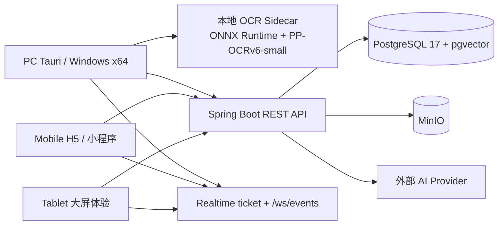
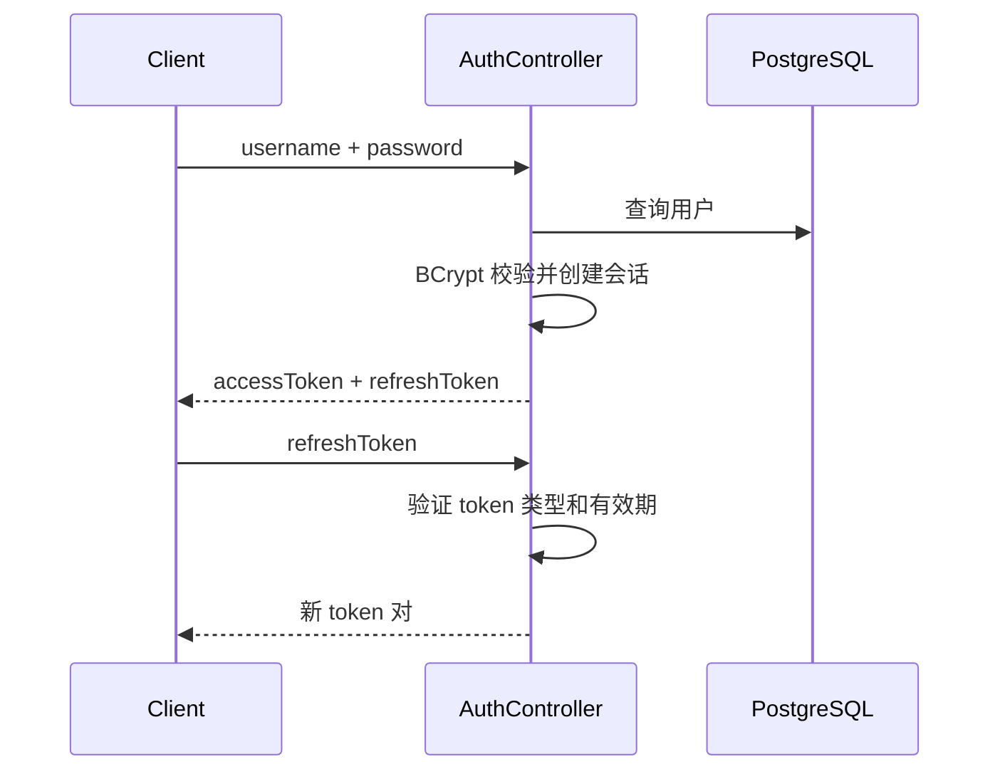
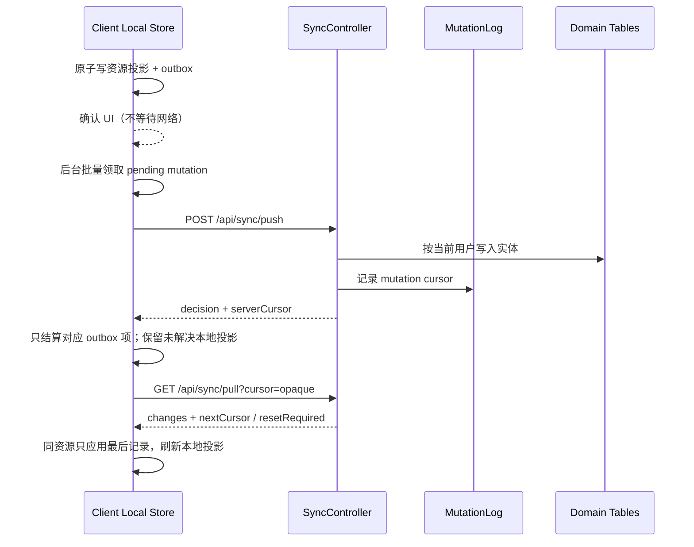
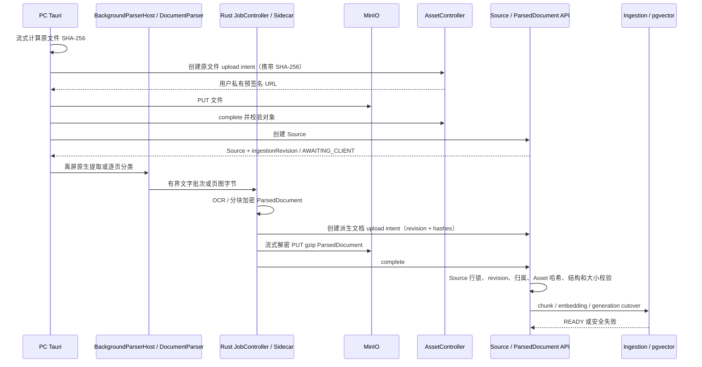

# Auralis 系统架构

更新时间：2026-10-11

文档状态：现行

权威范围：系统边界、组件关系、关键数据流、信任边界与架构风险

事实来源：当前 PC/Mobile/Server 代码、应用配置与 Docker Compose

## 总体结构

2026-10-09 本地范围更新（代码与自动验证通过，真实环境待验收）：PC Review/Stats 从本机读取，正式状态、历史和独立 outbox 与当前进程内轮次分开。沿现行 Tauri 单连接/JS 串行事务保存本地投影及命令意图，核心 KB 收敛后通过现有 lifecycle API 按 KB FIFO 补传，再导入权威状态/历史。真实操作时间用于调度与本地日统计，HTTP 载荷首次派发前固化，失败原样重试；后继仅由实际ACK前缀推进，未知首学需protocol2空历史证明。冲突保留，账号/设备/session 代际围栏沿现行票据，Review不读取无账号隔离旧缓存。Core Sync 白名单不扩展，Rust core snapshot 不触碰独立 Review 表。详细边界、实际命令与审查见 [本地计划](../plans/2026-10-09-review-stats-local-first.md)；以下 2026-10-08 outboxless 说明仅为此前范围。

2026-10-08 学科复习与学习生命周期：PC SubjectWorkspace 在同一路由提供Review/Stats中栏。Review Store按账号/设备/会话/学科在内存保存轮次、3R阶段、一次性巩固标记与冻结请求，切页继续，刷新/重启和会话变化清除。学习完成、初选、确认、纠正及重学调用独立Review lifecycle命令；Service沿Subject→KB→state锁序核对资源版本与正文hash，持久保存业务状态、不可变回执及同次最终结果投影。稳定阶段与mastered明确存储，旧events/history保留独立调用与精确回放；临时轮次不扩核心Sync，不写本地Review outbox。正文变化通过共享事件在原事务内失效资格，元信息保持。状态经owner cursor完整读取，Stats可重复读事务独立聚合三态、有效复习与学习完成。Focus独立链路仍只在个人页显示；当前代码/自动证据与真实环境边界见 [本轮实施](../plans/2026-10-08-review-learning-mastery-implementation.md)。

2026-10-01 学习数据补充：PC 专注运行时把实际耗时与最终事件原子保存到账号/设备隔离的本地表，稳定 session ID 上传至独立 `focus` 模块，Stats 聚合历史专注秒数与自然完成轮次。专注不生成 ReviewEvent。Profile 显示服务器权威聚合，避免提交超时后把本机 pending 再加一次。

AI Overview 生成边界继续无状态。PC 只将完整成功成果提交至 ai 模块中的独立结果表与写入回执表；GET/PUT 使用 owner、Source READY/revision、Subject 当前来源 manifest 和整体版本作围栏。PC durable outbox 的缓存与 intent 同事务保存，HTTP 载荷固化后按相同 clientWriteId 原样重试；文件成果先收敛再上传学科成果。此链路不扩展五类 core Sync 资源，提交后通过 `OVERVIEW_UPDATED` 提示重拉。

2026-10-11 Overview 取消实现：PC 在同一生成 POST 上选择 SSE，通过心跳、终端事件和消费者 AbortSignal 管理当前请求；服务端进程内共享 Source flight 按兴趣和原 owner 入口绝对期限关闭当前调用独占 socket。手动页面、后台 runtime 与同键消费者各自拥有取消范围，取消不删除成功结果或独立 outbox。生成资源有界，预检和排队计入单调绝对期限，独立 watchdog 发出终端超时，用量仅在实际调用退出后结算和释放。取消写入以最终同步提交 guard 为边界，进入提交后的成功成果保留。入口计时不强制中止 JDBC/数据库锁，preflight 阻塞可延迟 SSE 建立；原生 DNS 仅由固定资源隔离。无持久 Overview 作业、取消 API 或跨实例取消协调；JSON 保留默认兼容路径，其断连只能在写入后可靠观察。本机 TLS/TCP 自动验证通过，本地关闭 socket 不代表服务商撤回远端计算。实际命令、审查及发布边界见 [实施计划](../plans/2026-10-11-overview-hard-timeout-cancellation.md)。

PC Tauri SQL 插件加载后先由内部初始化命令固定单连接池（max/min 1，无正常 idle/lifetime 回收），再交给既有 JS 串行 SQL 队列。跨调用的 BEGIN/COMMIT 使用同一连接，完整缓存/intent 和专注状态/事件的本地原子提交因此不依赖默认多连接池的偶然分配；native snapshot 事务保持独立实现。



PC 和 Mobile/Tablet 是独立客户端工程。PC 的发布目标为 Windows x64 Tauri，PC Web 只保留内部开发用途；Mobile 与 Tablet 共用 Uni-app 工程和部分 Store/API/服务，但使用不同页面集合和布局。Server 是业务与 AI 中枢；客户端不得直接连接 PostgreSQL、pgvector、MinIO 或读取服务端 AI 密钥。PC 本地 OCR 只生成计划中的 ParsedDocument，不改变服务端对用户归属、索引和检索范围的权威。

### 2026-09-11 Server 门禁证据

`source` 模块现在拥有公开的 `ParsedDocumentIngestionPort` 与最小 `IngestionJobReference`；`ai.ingestion` 提供同步实现，source 不再依赖 ai 的内部服务或实体，保持 `ai → source` 的单向模块边界。架构隔离命令（含 `ArchitectureTests`）7 类合计 20/20，其中 `ArchitectureTests` 1/1。

Task 4 当前增量编译产物下的标准聚焦 Maven 命令实际为 40/40、0 failures、0 errors；全量 `mvnw -B -ntp test` 实际执行 239 项，0 failures、3 errors，错误仅为 MinIO、PgVector 与 PgVector migration 的 Docker/Testcontainers 环境不可用。一次 fresh `clean test-compile` 仍在 `AiProviderSecurityTests.java:182` 因匿名 `ProviderHttpTransport` 未实现当前 `post(..., byte[])` 而失败；该并行测试源码未在本任务修复。OpenAPI artifact 测试为 8/8，`check-openapi.ps1` 的 artifact 比对通过但报告 `Auralis-PC/src/api/generated/schema.ts` stale。

## 组件边界

### PC

- Vue Router 管理 8 条当前路由：Login、Dashboard、SubjectHall、SubjectWorkspace、Asset、Timeline、Profile、Pomodoro。无入口的 Home/Settings 已删除。
- Pinia 管理账号、知识块、任务、学科、同步、聊天和设置。
- API 层封装鉴权、同步、资产、统计和 AI。
- Tauri 提供桌面容器与 SQL 插件能力。
- 已批准但尚未实现的 AI 阅读目标在 Vue/WebView 内使用单实例离屏 `BackgroundParserHost` 串行承载 Office renderer，在 Rust 中管理任务、分块加密缓存、流式上传和长驻 Windows x64 OCR Sidecar；Vue 不获得通用 Shell 权限。

详细实现见 [PC 模块](../modules/FrontendPC.md)。

### Mobile / Tablet

- `pages.json` 管理手机与平板页面；微信通过条件编译只包含启动页和手机页面。
- Pinia 管理账号、块、任务、学科、同步、设备、布局和设置。
- services 管理本地数据库、手写引擎、笔记模型和仓库。
- Tablet 手写笔记由 feature flag 控制入口。

详细实现见 [Mobile / Tablet 模块](../modules/FrontendMobileTablet.md)。

### Server

- Spring Modulith 业务模块提供 REST/SSE 协议、领域服务和模块边界。
- Spring Security、JWT access token 和 refresh rotation 管理认证会话。
- Spring Data JPA + Flyway 管理业务数据；pgvector JDBC repository 管理 1024 维向量和 HNSW 检索。
- AssetStoragePort 连接 MinIO；AI Provider port 连接允许名单内的 OpenAI-compatible 服务。
- Realtime 使用一次性短期 ticket 建立 `/ws/events` 用户级事件连接。

详细实现见 [后端模块](../modules/Backend.md)。

### 基础设施

- PostgreSQL 17 + pgvector：用户、领域资源、同步、AI 会话、RAG chunk 与向量。
- MinIO：用户 Asset 对象，以及计划中的私有 ParsedDocument 派生对象。
- Spring Boot：REST、SSE、Realtime、摄入 worker 与 Provider 编排。
- PC Tauri：端侧 SQLite、受控本地解析与计划中的 OCR Sidecar。

正式 MSI 中 Sidecar 可执行文件使用 Tauri `bundle.externalBin`，OCR 模型、配置和许可证使用 `bundle.resources`；依赖和模型版本/哈希进入固定清单，运行时不下载。Sidecar 由 Rust 通过版本化 stdin/stdout 协议调用，不暴露本地端口，也不接受 Vue 提供的任意路径。

Redis、Milvus 和 etcd 属于已退役旧 Server 栈，不进入新后端目标拓扑。

## 信任边界

```text
用户输入 / 文件 / token
        ↓ 不可信
客户端请求封装
        ↓ Authorization / 参数校验
Spring Security + owner-scoped Controller
        ↓ 当前用户上下文
Service / Mapper / Storage / AI Provider
```

强制规则：

- 客户端传入的 userId、objectName、API key、base URL 和数据归属都不能直接信任。
- HTTP 受保护接口只接受 access token；refresh token 仅用于刷新端点。
- WebSocket 在握手、PING 和定时审计阶段验证 token。
- 所有用户数据查询和修改必须带当前用户边界。
- 外部文件内容和 AI 输出必须按不可信数据处理。

## 关键数据流

### 登录与刷新



客户端路由守卫只改善交互，不能替代 Server 的 access token 与 owner scope 校验。

### 本地优先同步



PC 普通 Store 只读取本地投影，启动、实时事件、联网恢复和读操作仅请求后台同步；不再经领域列表 API 全量刷新。服务端仍以 `baseVersion` 处理低频并发，冲突只更新本地同步/诊断状态，不静默覆盖用户最后一次本地编辑。删除必须在 mutation、pull 和冷启动之间保持软删除语义一致；双设备弱网、真实 Tauri 与 GUI 验收仍是风险项。

### 文件上传与 AI 摄入

以下流程是 2026-08-23 已批准、2026-08-24 技术复核修订的目标，当前仍处于计划状态；实现与验收状态以 current 文档为准。



FILE Source 的目标链路由 PC 统一生成 ParsedDocument，服务端不执行图片或扫描 PDF OCR。Office 后台解析必须由已挂载的离屏 renderer 完成，不能假设 Rust 能直接调用浏览器 File Viewer。TEXT/URL Source 继续由服务端解析。ParsedDocument 是不进入普通 Sync 的私有派生对象；服务端以 Source `ingestionRevision` 仲裁多设备并发 complete，最新成功代可用于重新分块或重新 Embedding。完整设计见 [PC Tauri AI 辅助阅读全流程设计](../design/2026-08-23-pc-tauri-ai-assisted-reading-design.md)。

### AI 调用与本人额度（2026-10-10 B 实施边界）

Chat retrieval + completion、整个 Overview MAP/REDUCE、ingestion job + generation 及 Provider 设置检查都经 `AiInvocationGateway` 建立任务 scope。准入/预留/派发标记短事务先锁真实 users 行并重查 ACTIVE，再按 GLOBAL → USER → TASK 获取账本锁；结算/续租不反向取 users 行锁，避免注销清理的级联死锁。派发标记是数据库授权点，不能撤销已授权的远端请求。成功接受与任务 owner/lease 在同一结算事务裁决，数据库事务结束后出站；独立有界 heartbeat 维持活跃任务和调用，响应按真实可空 usage 或保守估算结算。稳定 task key 只用于互斥，原始 key 不落库。进程异常后的 lease 回收与合作式 deadline 不能撤回服务商已经收到的请求。

ingestion 配额延期通过 next_attempt_at 控制重新领取，attempt_count 保留单调 claim 身份，failure_count 单独控制普通失败重试；不可恢复的请求/任务预算拒绝成为 fenced 终态。完成批次留在当前 generation 的 inactive chunks，重启后按当前内容和有效 claim 恢复；Source → job 检查点锁使用可写短事务，检索只读完整成功后原子激活的 generation。

PC、Mobile、Tablet 的现有个人中心通过当前 access token 请求 `GET /api/ai/usage`，只展示本人 UTC 小时/日额度，并将 resetAt 转为当地时间。客户端读取失败保留明确错误态；账号切换使旧请求代次失效。没有新页面、核心 Sync 资源或支付边界。系统每日额度仍包括删号后的匿名已消耗账本。

这是本轮代码已接入并取得相关自动证据的边界；最终审查与真实环境验收状态分别见 [B 实施计划](../plans/2026-10-10-ai-usage-guard-b.md)。六类额度异常由 AI 模块自己的 advice 处理，shared 不反向引用 AI。

### WebSocket 生命周期

1. 已认证客户端调用无请求体的 `POST /api/realtime/ticket`；服务端从 Bearer JWT 的 `serverDeviceId` 解析当前设备，不信任客户端提交设备字段。
2. 服务端返回一次性短期 ticket 与 `/ws/events` 地址；数据库只保存 ticket hash。
3. 客户端通过 query ticket 或 `X-Realtime-Ticket` 握手，ticket 过期、重放、跨用户或设备不匹配时拒绝。
4. 领域事务提交后发布用户级 `SYNC_CHANGED` / `REVIEW_UPDATED` 事件；当前实现为进程内订阅，跨实例 Broker 尚未接入。

自动测试已覆盖 ticket hash、过期、一次性消费、设备归属和提交后事件桥；真实客户端与跨实例行为仍需联调。

## 配置模型

- `application.yml`：JPA/Flyway、上传、同步、Realtime、AI 摄入与 Provider 公共配置。
- `application-local.yml`：本地开发行为与可观察性。
- `application-prod.yml`：生产禁用 API 文档，并要求数据库、JWT、MinIO、CORS 与 Provider 等关键环境变量。
- Compose：PostgreSQL/pgvector、MinIO、后端和开发用途前端容器；前端容器不代表 PC Web 发布目标。

生产部署必须从环境变量注入数据库、JWT、MinIO 和 AI 凭据，不能沿用开发默认值。

## 数据权威与缓存

| 数据 | 权威位置 | 客户端角色 |
| --- | --- | --- |
| 用户账号 | PostgreSQL | 保存 token 与最小用户状态 |
| 知识块、任务块 | PostgreSQL + 本地副本 | 离线操作、mutation、增量同步 |
| mutation cursor | Server mutation_log | 客户端保存 last cursor |
| 文件对象 | MinIO | 上传、展示、引用 objectName |
| PC 原始文件本地副本 | PC Tauri Local Asset Store | 当前设备持有的完整原始 Asset；本地稳定身份映射到 Server Asset，断网导入后最终同步，只有最后 Source 引用被用户删除时移除 |
| 资产元数据 | PostgreSQL asset | 客户端显示状态和学科归属 |
| RAG chunk 与向量 | PostgreSQL `source_chunks` + pgvector | 不直接持久化到客户端 |
| 文件/学科 AI 总览 | PC owner/device-scoped `ai_overview_cache` | Server 只执行无状态结构化生成；大纲、总结、输入指纹和安全失败摘要不进入 Sync 或 Server 数据库 |
| ParsedDocument（计划中） | 服务端私有对象 + 元数据；本地仅在接收前以 keyring 主密钥的分块 AES-GCM envelope 暂存 | PC 解析、断点恢复和 Rust 流式上传，服务端确认后删除本地正文 |
| Tablet 手写笔记 | 端侧 `tablet_notes` | 当前不进入 Server 同步 |

## 当前架构风险

| 风险 | 证据 | 架构影响 |
| --- | --- | --- |
| 本地 OCR 与安装包尚未完成人工验收 | 当前代码与自动测试已覆盖 OCR/ParsedDocument 路径，但尚无真实 Tauri/安装包证据 | 非文本型文件的实际 RAG 闭环仍不能视为业务验收完成 |
| ParsedDocument ingestion 边界已实现但真实依赖未验收 | `ParsedDocumentIngestionPort`、V15 派生表和 complete/indexing 流程已有代码与 H2 证据；PostgreSQL/MinIO 仍受外部环境限制 | 客户端解析结果的真实对象存储、索引与 generation cutover 仍需端到端证据 |
| 标准 Maven fresh testCompile 仍被并行测试 blocker 阻断 | `AiProviderSecurityTests.java:182` 的匿名 `ProviderHttpTransport` 缺少 `post(..., byte[])` 实现；架构隔离命令（含 `ArchitectureTests`）7 类合计 20/20，其中 `ArchitectureTests` 1/1 | 不能把隔离聚焦结果写成新鲜标准生命周期全绿 |
| OpenAPI 客户端生成类型过期 | artifact runtime comparison 与 Server `OpenApiArtifactTests` 8/8 通过，但 `check-openapi.ps1` 报 PC generated schema stale | PC 请求类型可能未反映最新 artifact，契约总门禁仍未关闭 |
| Docker/Testcontainers 不可用 | 全量 239 项仅 3 个容器集成 errors，Docker Engine named pipe 不可用 | PostgreSQL/pgvector/MinIO 真实依赖行为仍未由本机全量测试证明 |
| PC AI 上下文仍为字符串拼接 | 当前 chat store 未发送强类型 Source/Subject scope | 可能产生范围含糊或消息正文污染 |
| Office 后台解析路径未验证 | File Viewer 文本接口依赖已挂载 renderer，legacy PPT 可能使用 Canvas/WASM | 离屏解析宿主和逐页 OCR fallback 验证前，不能声称所有预览格式均可进入 RAG |
| Windows 安装包未验证 OCR 资源 | `externalBin/resources`、固定模型清单、长驻 Sidecar 和分块加密缓存仍未构建 | 不能声称离线 OCR、恢复或准确率达标 |
| 真实 Provider 与客户端联调未完成 | 当前证据以 Stub/受控 HTTP 和后端自动测试为主 | 不能替代网络、SSE、GUI 和业务验收 |

风险的当前优先级和关闭条件见 [问题和审查](../current/IssuesAndReview.md)。
