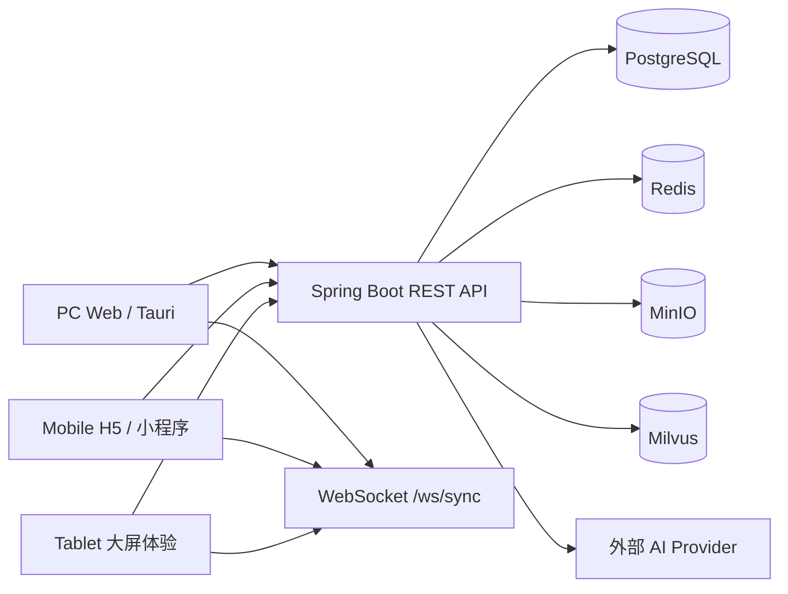
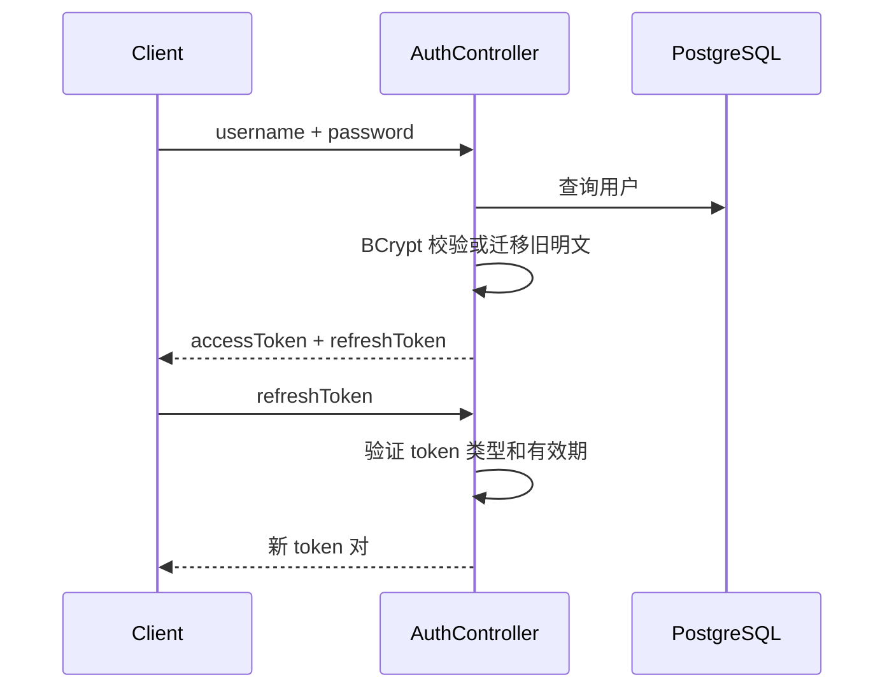
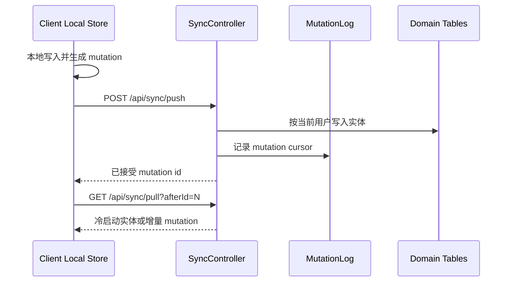
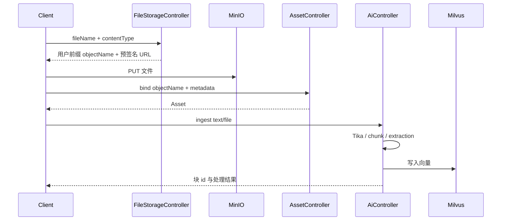

# Auralis 系统架构

更新时间：2026-07-10

文档状态：现行

权威范围：系统边界、组件关系、关键数据流、信任边界与架构风险

事实来源：当前 PC/Mobile/Server 代码、应用配置与 Docker Compose

## 总体结构



PC 和 Mobile/Tablet 是独立客户端工程。Mobile 与 Tablet 共用 Uni-app 工程和部分 Store/API/服务，但使用不同页面集合和布局。Server 是业务与 AI 中枢；客户端不得直接连接 PostgreSQL、Redis、Milvus 或读取服务端 AI 密钥。

## 组件边界

### PC

- Vue Router 管理 7 条当前路由。
- Pinia 管理账号、知识块、任务、学科、同步、聊天和设置。
- API 层封装鉴权、同步、资产、统计和 AI。
- Tauri 提供桌面容器与 SQL 插件能力。

详细实现见 [PC 模块](../modules/FrontendPC.md)。

### Mobile / Tablet

- `pages.json` 管理手机与平板页面；微信通过条件编译只包含启动页和手机页面。
- Pinia 管理账号、块、任务、学科、同步、设备、布局和设置。
- services 管理本地数据库、手写引擎、笔记模型和仓库。
- Tablet 手写笔记由 feature flag 控制入口。

详细实现见 [Mobile / Tablet 模块](../modules/FrontendMobileTablet.md)。

### Server

- Controller：REST 协议与参数边界。
- Service：业务规则、同步、AI 摄入和存储编排。
- Entity/Mapper：PostgreSQL 持久化。
- Config：数据库初始化、Redis、MinIO、LangChain4j、Milvus、线程池和 WebSocket。
- WebSocket：握手鉴权、心跳 token 更新、事件推送和连接审计。

详细实现见 [后端模块](../modules/Backend.md)。

### 基础设施

- PostgreSQL：用户、块、关系、mutation 和资产元数据。
- Redis：缓存、同步与 Stream 相关能力。
- MinIO：用户上传对象；当前 Compose 与 Milvus 共享同一 MinIO 服务。
- Milvus：知识向量。
- etcd：Milvus 元数据依赖。
- pgAdmin：本地数据库管理。

## 信任边界

```text
用户输入 / 文件 / token
        ↓ 不可信
客户端请求封装
        ↓ Authorization / 参数校验
Server Controller + AuthInterceptor
        ↓ 当前用户上下文
Service / Mapper / Storage / AI Provider
```

强制规则：

- 客户端传入的 userId、objectName、API key、base URL 和数据归属都不能直接信任。
- HTTP 受保护接口只接受 access token；refresh token 仅用于刷新端点。
- WebSocket 在握手、PING 和定时审计阶段验证 token。
- 所有用户数据查询和修改必须带当前用户边界。
- 外部文件内容和 AI 输出必须按不可信数据处理。

## 关键数据流

### 登录与刷新



当前 PC 路由守卫临时关闭属于客户端风险，不改变 Server 鉴权要求。

### 本地优先同步



删除必须在直接 CRUD、mutation、pull 和冷启动之间保持软删除语义一致。目前该一致性仍是风险项。

### 文件上传与 AI 摄入



当前绑定路径校验 objectName 用户前缀，但 MinIO 对象存在性、真实大小和 MIME 校验仍需补齐。

### WebSocket 生命周期

1. 客户端使用 query 参数携带 token 发起 `/ws/sync` 握手。
2. `WebSocketAuthInterceptor` 验证 token 并保存用户属性。
3. PING 消息可携带新 token；合法时更新 session 并返回 PONG。
4. 定时任务每 60 秒审计 token，缺失、无效或过期时关闭连接。

这些行为已由代码确认，但当前没有自动化测试源码，仍需联调或测试证据。

## 配置模型

- `application.yml`：公共 profile、上传限制、LangChain4j 与 Milvus 公共配置。
- `application-dev.yml`：开发数据库、Redis、MinIO 和 AI 默认配置。
- `application-prod.yml`：生产数据库环境变量，但仍使用 `spring.ai.openai` 旧口径，与主配置的 `langchain4j` 不一致。
- Compose：本地服务、默认密码和 volume。

生产部署必须从环境变量注入数据库、JWT、MinIO 和 AI 凭据，不能沿用开发默认值。

## 数据权威与缓存

| 数据 | 权威位置 | 客户端角色 |
| --- | --- | --- |
| 用户账号 | PostgreSQL | 保存 token 与最小用户状态 |
| 知识块、任务块 | PostgreSQL + 本地副本 | 离线操作、mutation、增量同步 |
| mutation cursor | Server mutation_log | 客户端保存 last cursor |
| 文件对象 | MinIO | 上传、展示、引用 objectName |
| 资产元数据 | PostgreSQL asset | 客户端显示状态和学科归属 |
| 向量 | Milvus | 不作为业务字段唯一副本 |
| Tablet 手写笔记 | 端侧 `tablet_notes` | 当前不进入 Server 同步 |

## 当前架构风险

| 风险 | 证据 | 架构影响 |
| --- | --- | --- |
| PC 守卫关闭 | `Auralis-PC/src/router/index.ts` | 客户端页面边界失效，但 Server 仍需强制鉴权 |
| 后端无测试源码 | `Auralis-Server/src/test` 为空 | 安全、同步、WebSocket 无回归保护 |
| 删除语义未统一验收 | CRUD 与 mutation 路径 | 多端可能恢复已删除数据 |
| 资产对象校验不完整 | Asset/FileStorage 实现 | 可绑定不存在或元数据不一致对象 |
| 生产 AI 配置分裂 | `application-prod.yml` | 生产可能无法加载预期模型 |
| DDL/Entity 漂移 | `task_block.position` | 字段存在但 Entity 未映射 |
| 迁移机制混合 | `DbMigrationConfig` + 单个 SQL | 变更顺序和回滚不可控 |
| 单 MinIO 服务复用 | Compose | 用户资产与 Milvus 内部对象权限边界不足 |
| 缺少 CI/监控/备份演练 | 仓库现状 | 发布和恢复缺少自动门禁 |

风险的当前优先级和关闭条件见 [问题和审查](../current/IssuesAndReview.md)。
