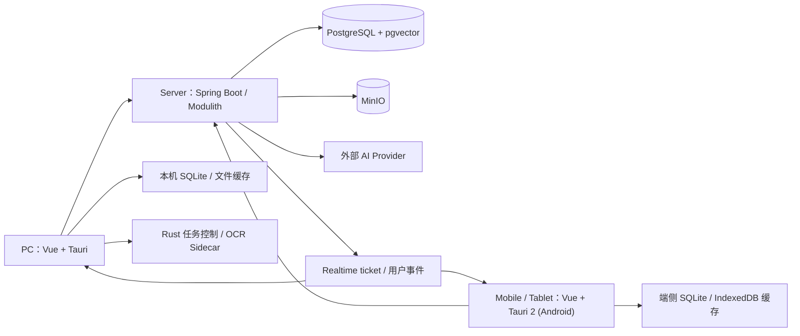
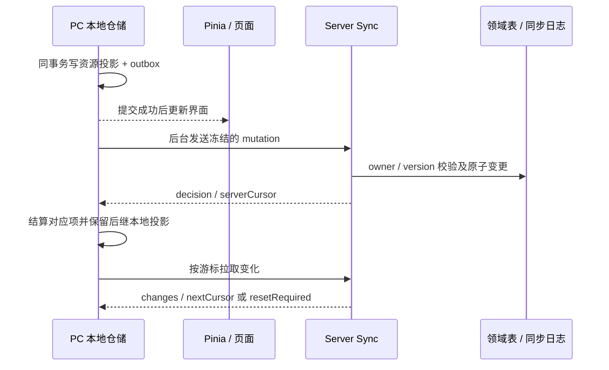

# Auralis 系统架构

更新时间：2026-11-27

文档状态：现行系统架构

事实来源：当前 PC / Mobile / Server 实现、应用配置与 Docker Compose，以及对应模块和契约文档。

权威范围：系统边界、组件关系、关键数据流、信任边界与架构约束。

本文按当前实现维护稳定架构。接口和数据字段分别以 [API](../contracts/API.md)、[数据库与端侧数据契约](../contracts/Database.md) 为准，验证进度与待修问题见 [当前状态](../current/Status.md) 和 [问题登记](../current/IssuesAndReview.md)。逐轮实现记录及旧方案保存在[整理前快照](../archive/snapshots/maintenance-2026-11-15/final-pass/project/Architecture.md)，不作为当前运行路径。

## 总体结构

PC 是 Windows x64 Tauri 客户端，Web 模式用于内部开发。Mobile 与 Tablet 共用 `Auralis-Mobile` 工程（Vue 3 + Vite + Tauri 2），构建时按 `VITE_APP_TARGET` 拆分为两个独立 Android 应用（竖屏 `Auralis` 与横屏 `Auralis HD`），各自只包含本端路由与资源；微信小程序与 Mobile H5 已退出发布范围。Server 管理认证、资源归属、同步、文件摄入、AI 调用与正式结果。客户端不直接访问数据库或服务端密钥；对象上传通过服务端签发、限定资源和用途的预签名 URL 完成。

| 组件 | 职责 | 详细说明 |
| --- | --- | --- |
| PC | Vue Router / Pinia、端侧仓储和 outbox、Tauri SQLite、文件解析和 OCR、AI 阅读与本地复习 | [PC 模块](../modules/FrontendPC.md) |
| Mobile / Tablet | 手机和平板页面、共享 API / Store / 本地服务、独立手写数据 | [Mobile / Tablet 模块](../modules/FrontendMobileTablet.md) |
| Server | identity、subject、source、knowledge、task、relation、review、focus、sync、ai、stats、realtime 等领域模块 | [后端模块](../modules/Backend.md) |
| 基础设施 | PostgreSQL 17 + pgvector、MinIO、后端及开发用途前端容器 | [基础设施](../modules/Infrastructure.md) |

Server 使用 Java 21、Spring Boot、Spring Modulith、JPA / Flyway。向量与业务记录同在 PostgreSQL，pgvector 承担检索。MinIO 保存原始 Asset 和私有派生文档。Compose 不包含 Redis、Milvus、etcd 或 OCR 服务；OCR 位于 PC 本机。

## 信任、事务与资源生命周期

- HTTP 受保护接口验证 access token、当前用户和凭据代次；refresh token 只进入续期端点。客户端路由守卫不能替代服务端鉴权。
- 资源读写必须同时检查 owner、有效状态和版本。客户端提供的用户 ID、对象路径、Provider URL、文件与模型输出均不构成可信授权依据。
- 跨资源变更保持固定锁序：多个 Subject 按 UUID 排序；Subject 锁后再锁具体资源并重读。Task 路径按 user → subject → task；Source / Asset 按 subject → source → asset，清理路径不反向取锁。
- Subject 删除在同一业务边界内软删除关联 Source、Knowledge、Task、Relation；恢复 Subject 不自动恢复子资源。删除 Source 保留已有 KnowledgeBlock 及来源引用，新建或变更关联仍需有效来源。
- 资产回收先标记 ORPHANED，再于事务提交后删除对象；失败保留可重试状态与元数据。账号注销使用独立异步清理边界，不等同于立即清空全部外部文件或日志。
- Provider 出站受地址、重定向、响应体积、期限和取消边界约束；应用关闭连接不代表供应商已经撤回远端计算。诊断日志默认安全摘要，显式启用的原文/trace 导出可能含私有内容，须按对应运维规则管理。

## 关键数据流

### 认证与会话

注册和邮箱重置密码使用按用途隔离的邮箱验证码，保存摘要、期限和尝试限制。登录接受用户名或已验证邮箱。改密和密码重置递增凭据代次，使旧访问令牌在后续认证时失效；已登录改密保留操作设备续期，邮箱重置撤销全部续期会话。

PC 将账号、设备及登录代次带入异步提交围栏；明确的无效续期响应清理会话，临时网络失败保留可恢复状态。启动先完成本地数据库初始化，再进入依赖本地数据的业务与同步流程。

### 本地优先与核心同步

PC 的本地成功不等待远端同步。outbox 以用户、设备、稳定 mutation ID 和载荷指纹限定重试；已派发载荷不能随意重写。服务端逐条事务执行，预期业务拒绝回滚后另存回执，未知基础设施异常不伪装业务成功。游标、墓碑和 resetRequired 共同约束增量恢复。

Tauri SQL 插件使用单连接池，JS 队列串行处理跨调用事务；Rust 原生快照保留自身事务边界。跨窗口写入仍校验本地基线。排期命令本地即时提交、远端按持久顺序结算，成功回执保留后继乐观排期；换位/插入由服务端原子执行。详见 PC、API 和数据库契约。

### Review、Focus 与 Stats

Review 使用独立生命周期接口、状态、不可变回执和历史，不扩展核心 Sync 资源。服务端按 subject → knowledge → review state 锁序核对版本、正文 hash 和因果目标；正文修改使旧复习资格失效。PC 持久保存复习投影和独立 outbox，在知识块同步收敛后顺序补传；进程内轮次不是正式业务状态。

Focus 以稳定 session ID 独立幂等上传，不生成 ReviewEvent。Stats 依当前 owner 和时区聚合权威记录，不能在服务器已计入后重复叠加本机 pending。Mobile 与 Tablet 复习页面均已接入现行生命周期 API（`useMobileLifecycleReview`），离线待确认命令按用户与设备范围持久化并支持幂等重试；物理真机与多设备并发仍须单独验收。

### 文件上传、解析与摄入

1. PC 为原始文件计算 SHA-256，通过 Asset upload intent 上传并 complete，创建关联 FILE Source。
2. PC 的离屏解析宿主提取内容，Rust 任务与 OCR Sidecar 处理所需页面；ParsedDocument 在本地加密暂存并上传至私有对象存储。
3. Server complete 在事务外读取及验证对象，在短事务内复核活动账号、owner、Source revision 与接收状态，再原子接受解析结果、更新资料状态并创建索引任务。
4. 摄入 worker 在 lease、attempt 与 revision 围栏内分块、Embedding，完成后原子切换有效 generation；检索只读成功激活的代。

FILE 的文本提取与 OCR 由 PC Tauri 执行，Mobile/Tablet 不部署该解析模块；TEXT / URL 沿服务端路径。私有 ParsedDocument 不进入普通 Sync。恢复优先复用当前修订已接受的解析文档，否则轮换 revision 返回 AWAITING_CLIENT；旧 claim 不能提交迟到结果。网络暂停由用户明确继续，不能把本地上传完成等同于服务端 INDEXING / READY。

本机原始文件、解析暂存和服务端 Asset 各有独立生命周期；服务端确认后的解析正文清理不等于删除原始文件。打包资源、Keyring、真实文件类型与 OCR 质量需单独验收，详见 [PC 模块](../modules/FrontendPC.md)。

### AI 执行、费用与取消

Chat、Overview、摄入和 Provider 检查通过 AI Gateway / Guard 建立任务及调用边界。平台凭据与 BYOK 的费用策略独立于技术容量、任务次数和并发保护；Embedding 的窗口策略也不能替代运行保护。

准入、预留、派发标记先复核有效用户，再按固定账本锁序执行。派发标记是数据库授权点；已派发请求、未知 usage 与已结算费用不会因页面取消或任务恢复自动消失。真实 reservation、任务身份、lease / fence 与提交资格共同约束恢复和迟到结果。短事务结束后才执行出站调用，结算不反向取得用户锁。

### Chat

Chat 使用持久 conversation / run / attempt 与协议 1。每次 attempt 捕获 owner、阅读范围、READY Source 和 revision；默认检索只读捕获范围，显式来源只能缩窄范围。模型通过原生 function tools 请求数据与展示；结构化参数经过有界装配和校验，文本及展示内容按首次出现顺序进入 public parts。

公开展示与私有 evidence 分离，活动保存仍验证 owner / source fence。UNKNOWN 状态需要显式恢复，恢复不意味着退款或远端停止。PC / Mobile 的协议接入、后端验证和真实客户端业务验收分别记录。完整公开边界见 [Chat Runtime API](../contracts/chat-runtime-api.md)。

### Overview

当前详细生成算法为 `overview-markdown-v2`。生成流程由来源输入准备、CLEAN、OUTLINE、SUMMARY 组成；超容量输入由有界分批路径处理，共享原任务预算、期限及 owner / revision 围栏。容量须由有效模型配置确定，不凭空假设上下文大小。清理副本不改原解析资产。

公开成果使用 schemaVersion 2 的 `outlineMarkdown` / `summaryMarkdown`。生成与正式保存分离：完整成功内容由独立结果服务以输入描述、来源修订、指纹、真实 baseVersion 和 clientWriteId 回执保存；PC 缓存与待写意图同事务持久化。Overview 不进入核心 Sync，更新事件只提示重拉。PC SQLite schema 14 保存 Markdown 字段。

历史 schema 1 内容保留但不作为当前 Markdown 读取、不自动转换；替换按旧行真实版本提交完整 ALL。旧私有 INDEX / ROUTE / WRITER、preview / publication 和持久后台 Overview jobs 不属于当前生成或公开接口。Overview 通过文件、学科直接生成接口执行；PC 自动生成文件概览也使用该路径。历史作业表和元数据保留，不恢复执行或自动转换；历史私有载荷仍受保留期和来源撤销清理约束；直接生成所需的调用账本与安全重试校验继续保留。详细契约见 [API](../contracts/API.md)。

### Realtime

客户端先以 Bearer 请求 `POST /api/realtime/ticket`，服务端绑定当前设备，只保存一次性短期 ticket 的 hash。握手通过一次性 ticket 建立 `/ws/events`，连接按用户订阅变化事件。长连接在会话撤销后的失效与重连行为仍需单独核实、验收。

事务提交后发送用户级变化事件；事件用于触发正式同步或结果重拉，不作为权威业务数据。当前进程内事件连接不能替代跨实例消息 Broker。

## 数据权威与部署边界

| 数据 | 权威及端侧边界 |
| --- | --- |
| 账号与会话 | Server 身份存储；客户端仅持有当前会话材料和展示状态 |
| 核心资源 | Server 版本与同步日志；PC 本地副本和 outbox 承接离线编辑 |
| 原始 Asset | MinIO 对象与 Server 元数据；PC 可持有当前设备的原始文件副本 |
| ParsedDocument / RAG | 私有对象、元数据、成功 generation 的 chunks / 向量；不开放客户端直连 |
| Overview | Server 正式结果与写回执；PC owner / device / scope / revision 隔离缓存及待写队列 |
| Review / Focus | 独立服务端业务记录；PC 对应本地投影及补传队列 |
| Tablet 手写笔记 | 本地独立数据域；已确认自由画布仅本机自动保存与手动导出，不进入 Server 同步；完整画布能力待实施 |

运行配置分别由 application 配置、Compose 和环境变量承担；生产数据库、JWT、MinIO、邮件与 AI 凭据不能沿用开发默认值。PostgreSQL 与 MinIO 使用命名卷，仓库根目录中的普通目录不代表容器实际数据卷。配置与备份操作见 [基础设施](../modules/Infrastructure.md)。

## 当前验证边界

本文描述源码职责，不将代码存在、测试通过、部署完成和业务验收混为一项。当前需持续关注 Mobile Review 契约接入，以及真实 Tauri / 安装包、跨设备离线同步、OCR / Keyring、真实 Provider 和生产备份恢复。账号隔离等修复的验证与现场边界、具体优先级和关闭条件只在 [当前状态](../current/Status.md) 和 [问题登记](../current/IssuesAndReview.md) 维护，不在此复制某次 Docker 状态或旧测试计数。
